<link rel="stylesheet" href="{{ '/vintage-story/forgotten-armory/hussar/hussar.css' | relative_url }}">
<link rel="stylesheet" href="{{ '/vintage-story/forgotten-armory/portfolio.css' | relative_url }}">

<a href="{{ '/vintage-story/forgotten-armory/' | relative_url }}">← Forgotten Armory</a>

<header class="hussar-hero">
FORGOTTEN ARMORY · COLLECTION
<h1>Hussar</h1>
Dragoon and Cavalier sets, decorations and material poses.
</header>
<nav class="hussar-navigation" aria-label="Hussar sections"><a href="#introduction">Introduction</a><a href="#szyszak-helmet">Szyszak Head</a><a href="#szyszak-covered-helmet">Szyszak covered Head</a><a href="#szyszak-masked-helmet">Szyszak masked Head</a><a href="#kapalin-helmet">Kapalin Head</a><a href="#kapalin-covered-helmet">Kapalin covered Head</a><a href="#kapalin-masked-helmet">Kapalin masked Head</a><a href="#dragoon-chestplate">Dragoon Body</a><a href="#dragoon-legplate">Dragoon Legs</a><a href="#cavalier-chestplate">Cavalier Body</a><a href="#cavalier-legplate">Cavalier Legs</a><a href="#poses">Poses</a></nav>
<section id="introduction" class="hussar-section" aria-labelledby="introduction-title"><h2 id="introduction-title">Introduction</h2>
<figure class="hussar-card fa-introduction-set" id="captain-set">
            <a href="images/introduction/dragonset.png">
              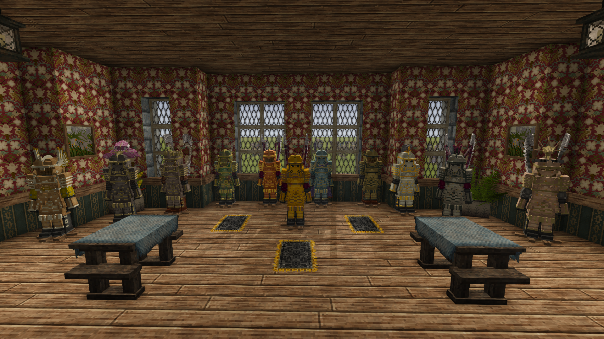
            </a>
            <figcaption>Dragoon set</figcaption>
          </figure>
          <figure class="hussar-card fa-introduction-set" id="guard-set">
            <a href="images/introduction/cavalierset.png">
              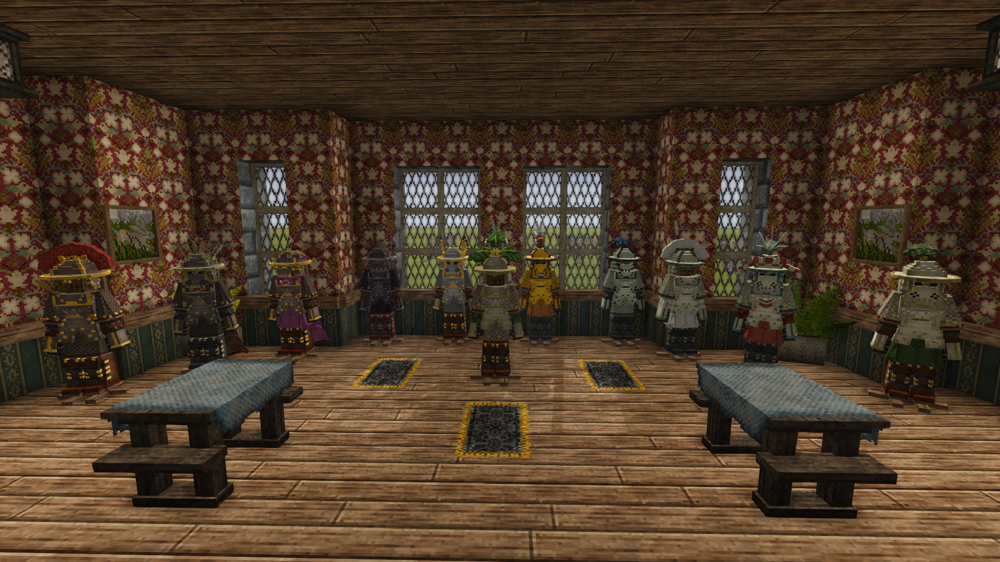
            </a>
            <figcaption>Cavalier set</figcaption>
          </figure>
          
</section>
<section id="szyszak-helmet" class="hussar-section" aria-labelledby="szyszak-helmet-title">
  <h2 id="szyszak-helmet-title">Szyszak — Head ornaments</h2>
  
Decoration variants.

  

    <h3>Communis</h3>
    

          <figure class="hussar-card">
            <a href="images/szyszak-helmet/communis/pennae.png">
              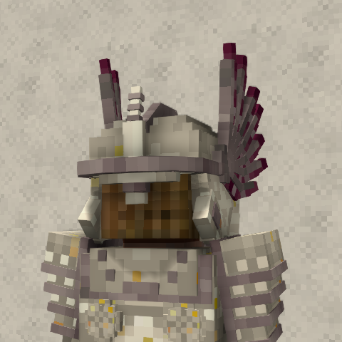
            </a>
            <figcaption>Communis-Pennae</figcaption>
          </figure>
          <figure class="hussar-card">
            <a href="images/szyszak-helmet/communis/pluma.png">
              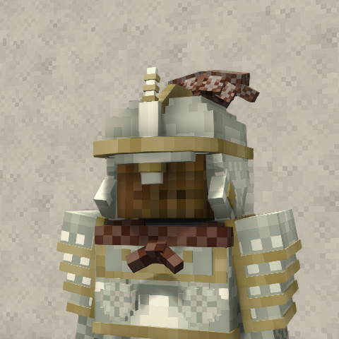
            </a>
            <figcaption>Communis-Pluma</figcaption>
          </figure>
          <figure class="hussar-card">
            <a href="images/szyszak-helmet/communis/crista.png">
              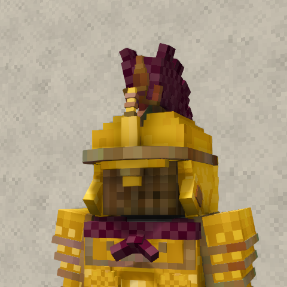
            </a>
            <figcaption>Communis-Crista</figcaption>
          </figure>
          <figure class="hussar-card">
            <a href="images/szyszak-helmet/communis/pinna.png">
              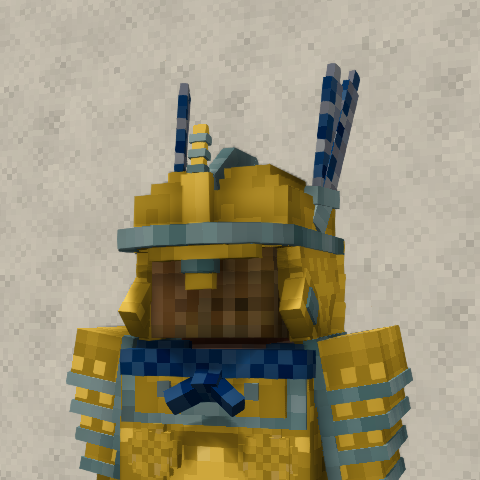
            </a>
            <figcaption>Communis-Pinna</figcaption>
          </figure>
          <figure class="hussar-card">
            <a href="images/szyszak-helmet/communis/sertum.png">
              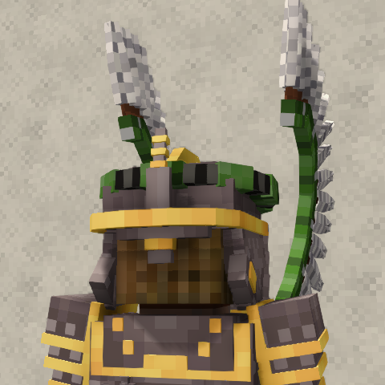
            </a>
            <figcaption>Communis-Sertum</figcaption>
          </figure>
          <figure class="hussar-card">
            <a href="images/szyszak-helmet/communis/transversa.png">
              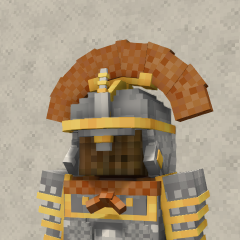
            </a>
            <figcaption>Communis-Transversa</figcaption>
          </figure>
          <figure class="hussar-card">
            <a href="images/szyszak-helmet/communis/statua.png">
              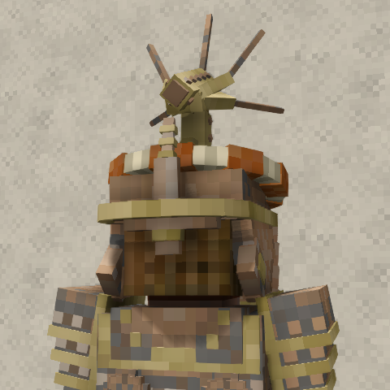
            </a>
            <figcaption>Communis-Statua</figcaption>
          </figure>
          <figure class="hussar-card">
            <a href="images/szyszak-helmet/communis/cauda.png">
              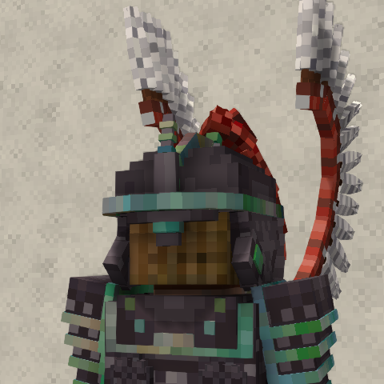
            </a>
            <figcaption>Communis-Cauda</figcaption>
          </figure>

        <figure class="hussar-card">
            
            <figcaption>Communis-Laurea</figcaption>
          </figure>
        <figure class="hussar-card">
            
            <figcaption>Communis-Corona</figcaption>
          </figure>
        <figure class="hussar-card">
            
            <figcaption>Communis-Cervinus</figcaption>
          </figure>
        <figure class="hussar-card">
            
            <figcaption>Communis-Arietinus</figcaption>
          </figure>
        <figure class="hussar-card">
            
            <figcaption>Communis-Taurinus</figcaption>
          </figure>
    <figure class="hussar-card">
            <a href="images/szyszak-helmet/animal/bear.png">
              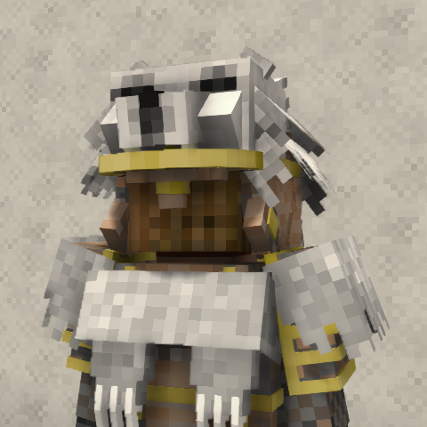
            </a>
            <figcaption>Animal-Bear</figcaption>
          </figure>
          <figure class="hussar-card">
            <a href="images/szyszak-helmet/animal/wolf.png">
              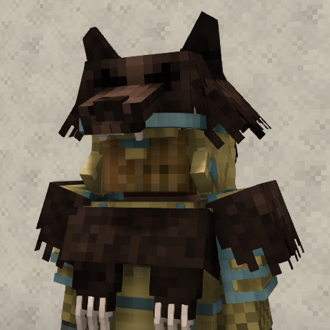
            </a>
            <figcaption>Animal-Wolf</figcaption>
          </figure>
    

  

  

    <h3>Regalis</h3>
    

          <figure class="hussar-card">
            <a href="images/szyszak-helmet/regalis/crista.png">
              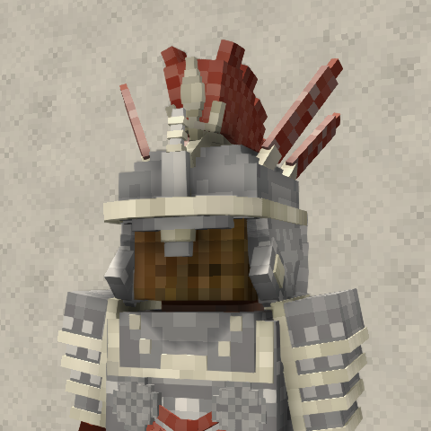
            </a>
            <figcaption>Regalis-Crista</figcaption>
          </figure>
          <figure class="hussar-card">
            
            <figcaption>Regalis-Transversa</figcaption>
          </figure>
          <figure class="hussar-card">
            
            <figcaption>Regalis-Pennae</figcaption>
          </figure>
          <figure class="hussar-card">
            
            <figcaption>Regalis-Pinna</figcaption>
          </figure>
          <figure class="hussar-card">
            <a href="images/szyszak-helmet/regalis/pluma.png">
              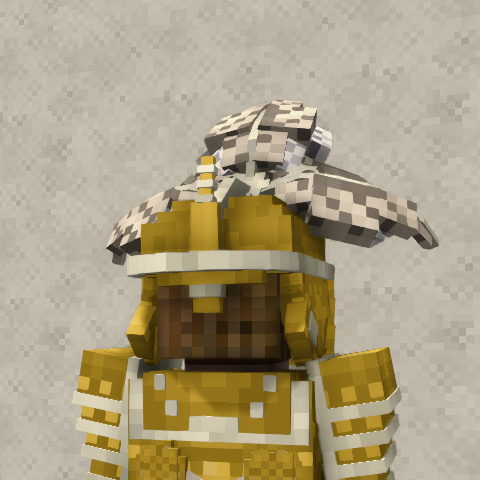
            </a>
            <figcaption>Regalis-Pluma</figcaption>
          </figure>
          <figure class="hussar-card">
            <a href="images/szyszak-helmet/regalis/sertum.png">
              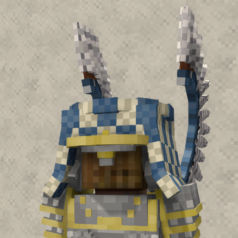
            </a>
            <figcaption>Regalis-Sertum</figcaption>
          </figure>
          <figure class="hussar-card">
            <a href="images/szyszak-helmet/regalis/statua.png">
              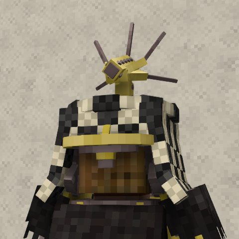
            </a>
            <figcaption>Regalis-Statua</figcaption>
          </figure>
          <figure class="hussar-card">
            
            <figcaption>Regalis-Cauda</figcaption>
          </figure>

        <figure class="hussar-card">
            
            <figcaption>Regalis-Laurea</figcaption>
          </figure>
        <figure class="hussar-card">
            
            <figcaption>Regalis-Corona</figcaption>
          </figure>
        <figure class="hussar-card">
            
            <figcaption>Regalis-Cervinus</figcaption>
          </figure>
        <figure class="hussar-card">
            
            <figcaption>Regalis-Arietinus</figcaption>
          </figure>
        <figure class="hussar-card">
            
            <figcaption>Regalis-Taurinus</figcaption>
          </figure>
    

  

  

    <h3>Metallicus</h3>
    

          <figure class="hussar-card">
            <a href="images/szyszak-helmet/metallicus/laurea.png">
              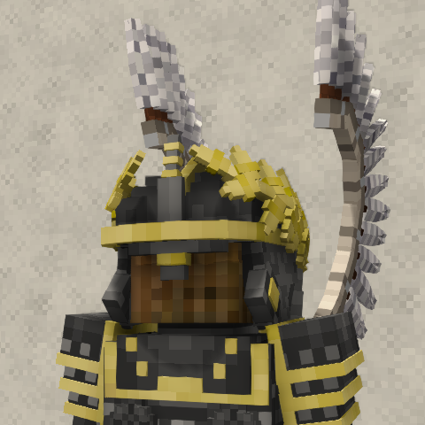
            </a>
            <figcaption>Metallicus-Laurea</figcaption>
          </figure>
          <figure class="hussar-card">
            <a href="images/szyszak-helmet/metallicus/corona.png">
              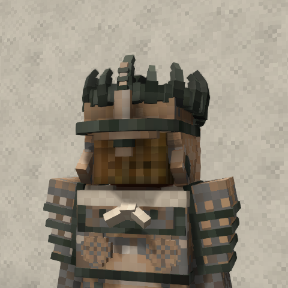
            </a>
            <figcaption>Metallicus-Corona</figcaption>
          </figure>
          <figure class="hussar-card">
            
            <figcaption>Metallicus-Cervinus</figcaption>
          </figure>
          <figure class="hussar-card">
            <a href="images/szyszak-helmet/metallicus/arietinus.png">
              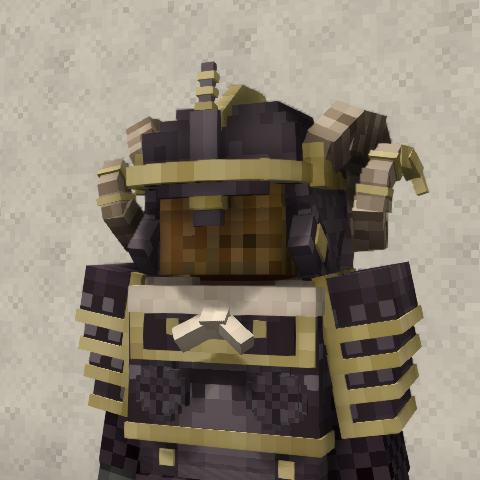
            </a>
            <figcaption>Metallicus-Arietinus</figcaption>
          </figure>
          <figure class="hussar-card">
            
            <figcaption>Metallicus-Taurinus</figcaption>
          </figure>
    
<figure class="hussar-card">
            <a href="images/szyszak-helmet/metallicus/statua.png">
              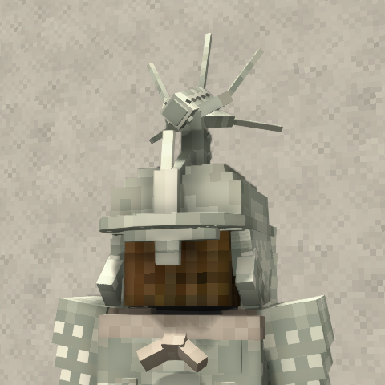
            </a>
            <figcaption>Metallicus-Statua</figcaption>
          </figure>

  

  </section>
<section id="szyszak-covered-helmet" class="hussar-section" aria-labelledby="szyszak-covered-helmet-title">
  <h2 id="szyszak-covered-helmet-title">Szyszak Covered — Head ornaments</h2>
  
Decoration variants.

  

    <h3>Communis</h3>
    

          <figure class="hussar-card">
            <a href="images/szyszak-covered-helmet/communis/pennae.png">
              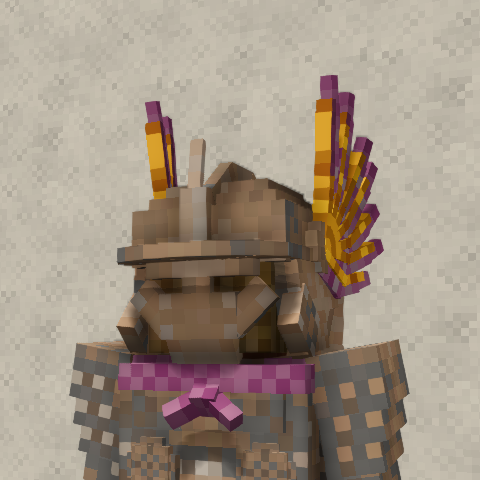
            </a>
            <figcaption>Communis-Pennae</figcaption>
          </figure>
          <figure class="hussar-card">
            <a href="images/szyszak-covered-helmet/communis/pluma.png">
              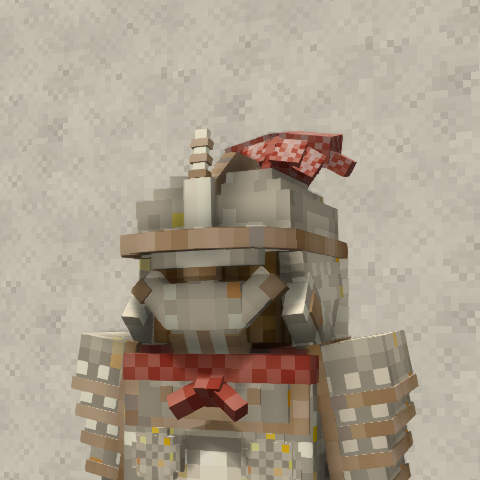
            </a>
            <figcaption>Communis-Pluma</figcaption>
          </figure>
          <figure class="hussar-card">
            <a href="images/szyszak-covered-helmet/communis/crista.png">
              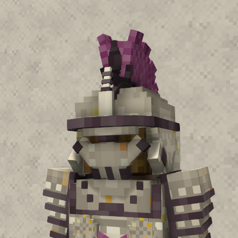
            </a>
            <figcaption>Communis-Crista</figcaption>
          </figure>
          <figure class="hussar-card">
            <a href="images/szyszak-covered-helmet/communis/pinna.png">
              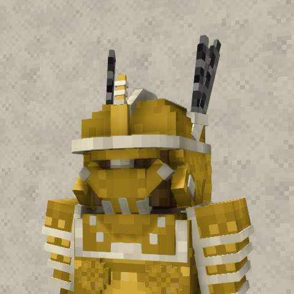
            </a>
            <figcaption>Communis-Pinna</figcaption>
          </figure>
          <figure class="hussar-card">
            <a href="images/szyszak-covered-helmet/communis/sertum.png">
              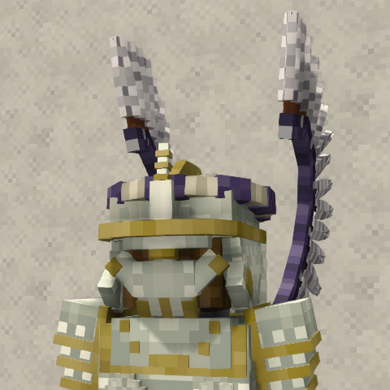
            </a>
            <figcaption>Communis-Sertum</figcaption>
          </figure>
          <figure class="hussar-card">
            <a href="images/szyszak-covered-helmet/communis/transversa.png">
              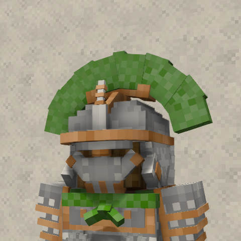
            </a>
            <figcaption>Communis-Transversa</figcaption>
          </figure>
          <figure class="hussar-card">
            <a href="images/szyszak-covered-helmet/communis/statua.png">
              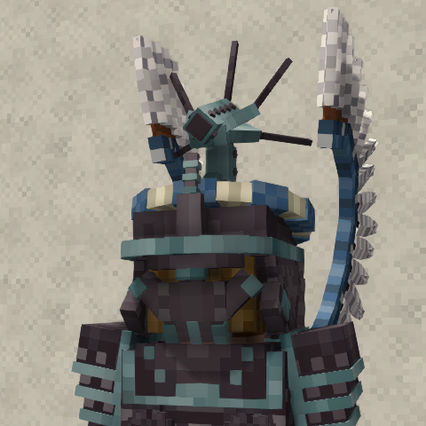
            </a>
            <figcaption>Communis-Statua</figcaption>
          </figure>
          <figure class="hussar-card">
            <a href="images/szyszak-covered-helmet/communis/cauda.png">
              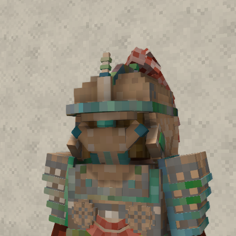
            </a>
            <figcaption>Communis-Cauda</figcaption>
          </figure>

        <figure class="hussar-card">
            
            <figcaption>Communis-Laurea</figcaption>
          </figure>
        <figure class="hussar-card">
            
            <figcaption>Communis-Corona</figcaption>
          </figure>
        <figure class="hussar-card">
            
            <figcaption>Communis-Cervinus</figcaption>
          </figure>
        <figure class="hussar-card">
            
            <figcaption>Communis-Arietinus</figcaption>
          </figure>
        <figure class="hussar-card">
            
            <figcaption>Communis-Taurinus</figcaption>
          </figure>
    <figure class="hussar-card">
            <a href="images/szyszak-covered-helmet/animal/bear.png">
              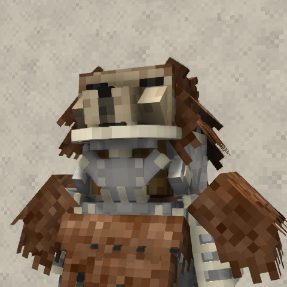
            </a>
            <figcaption>Animal-Bear</figcaption>
          </figure>
          <figure class="hussar-card">
            <a href="images/szyszak-covered-helmet/animal/wolf.png">
              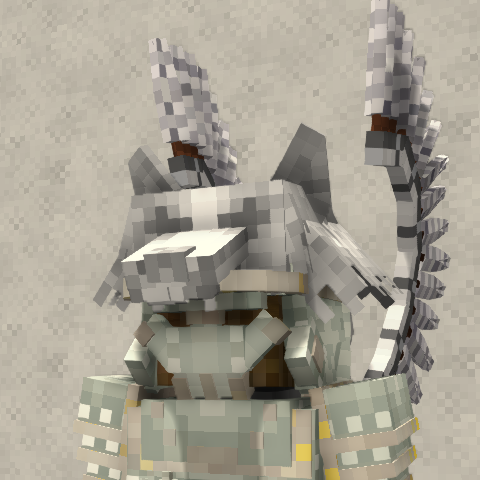
            </a>
            <figcaption>Animal-Wolf</figcaption>
          </figure>
    

  

  

    <h3>Regalis</h3>
    

          <figure class="hussar-card">
            <a href="images/szyszak-covered-helmet/regalis/crista.png">
              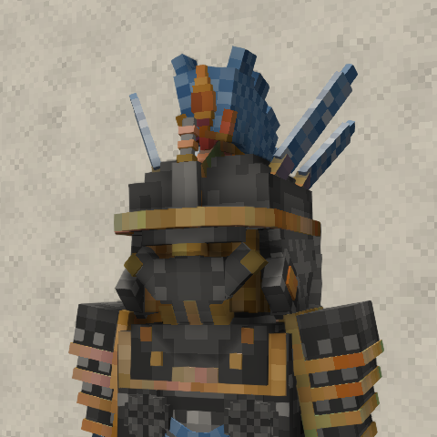
            </a>
            <figcaption>Regalis-Crista</figcaption>
          </figure>
          <figure class="hussar-card">
            
            <figcaption>Regalis-Transversa</figcaption>
          </figure>
          <figure class="hussar-card">
            
            <figcaption>Regalis-Pennae</figcaption>
          </figure>
          <figure class="hussar-card">
            
            <figcaption>Regalis-Pinna</figcaption>
          </figure>
          <figure class="hussar-card">
            <a href="images/szyszak-covered-helmet/regalis/pluma.png">
              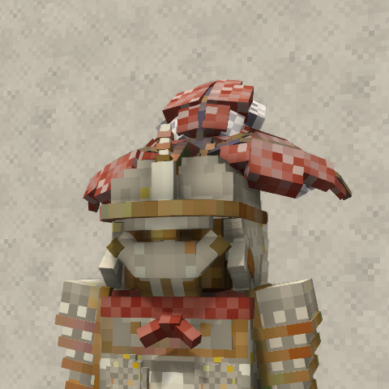
            </a>
            <figcaption>Regalis-Pluma</figcaption>
          </figure>
          <figure class="hussar-card">
            <a href="images/szyszak-covered-helmet/regalis/sertum.png">
              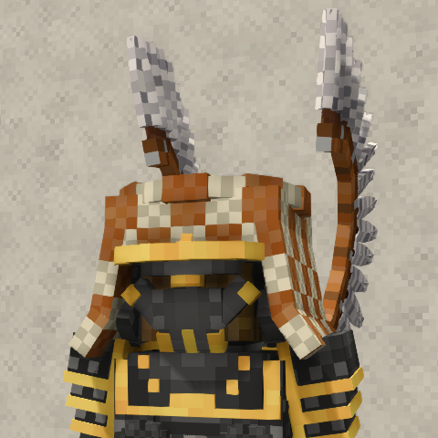
            </a>
            <figcaption>Regalis-Sertum</figcaption>
          </figure>
          <figure class="hussar-card">
            <a href="images/szyszak-covered-helmet/regalis/statua.png">
              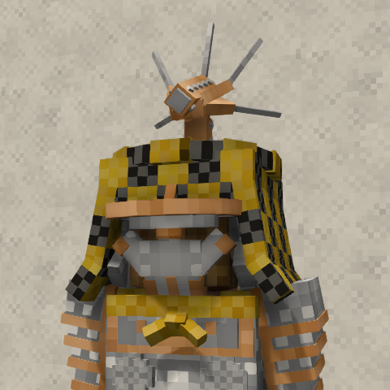
            </a>
            <figcaption>Regalis-Statua</figcaption>
          </figure>
          <figure class="hussar-card">
            
            <figcaption>Regalis-Cauda</figcaption>
          </figure>

        <figure class="hussar-card">
            
            <figcaption>Regalis-Laurea</figcaption>
          </figure>
        <figure class="hussar-card">
            
            <figcaption>Regalis-Corona</figcaption>
          </figure>
        <figure class="hussar-card">
            
            <figcaption>Regalis-Cervinus</figcaption>
          </figure>
        <figure class="hussar-card">
            
            <figcaption>Regalis-Arietinus</figcaption>
          </figure>
        <figure class="hussar-card">
            
            <figcaption>Regalis-Taurinus</figcaption>
          </figure>
    

  

  

    <h3>Metallicus</h3>
    

          <figure class="hussar-card">
            <a href="images/szyszak-covered-helmet/metallicus/laurea.png">
              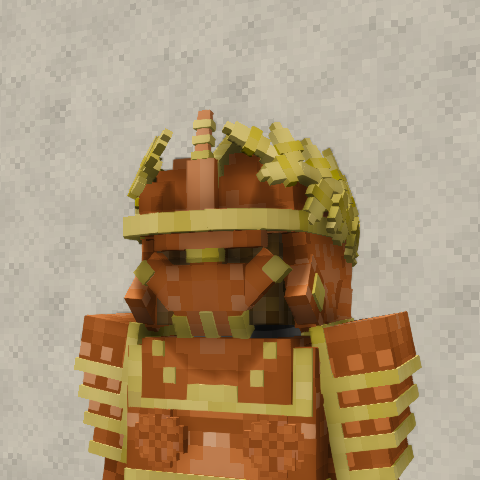
            </a>
            <figcaption>Metallicus-Laurea</figcaption>
          </figure>
          <figure class="hussar-card">
            <a href="images/szyszak-covered-helmet/metallicus/corona.png">
              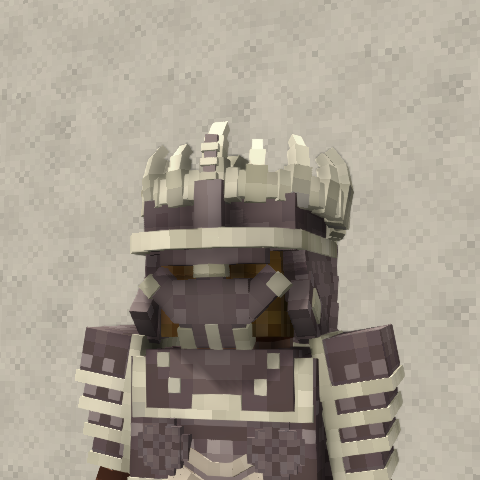
            </a>
            <figcaption>Metallicus-Corona</figcaption>
          </figure>
          <figure class="hussar-card">
            
            <figcaption>Metallicus-Cervinus</figcaption>
          </figure>
          <figure class="hussar-card">
            <a href="images/szyszak-covered-helmet/metallicus/arietinus.png">
              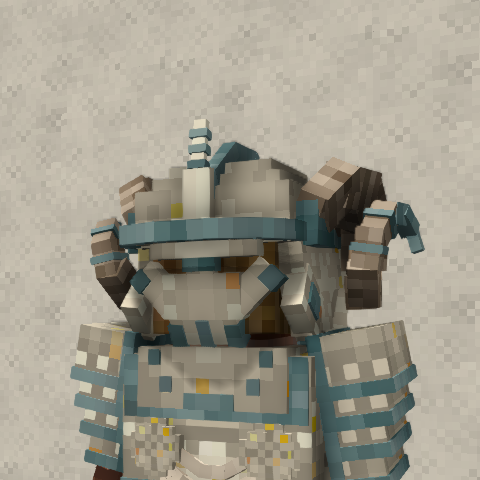
            </a>
            <figcaption>Metallicus-Arietinus</figcaption>
          </figure>
          <figure class="hussar-card">
            <a href="images/szyszak-covered-helmet/metallicus/taurinus.png">
              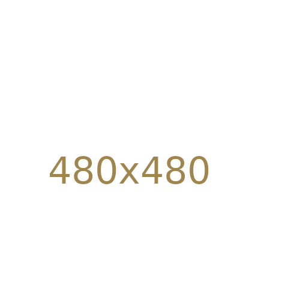
            </a>
            <figcaption>Metallicus-Taurinus</figcaption>
          </figure>
    
<figure class="hussar-card">
            <a href="images/szyszak-covered-helmet/metallicus/statua.png">
              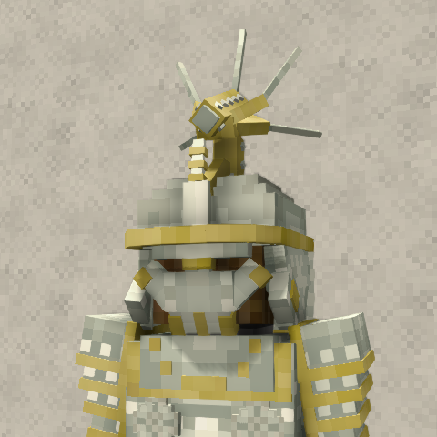
            </a>
            <figcaption>Metallicus-Statua</figcaption>
          </figure>

  

  </section>
<section id="szyszak-masked-helmet" class="hussar-section" aria-labelledby="szyszak-masked-helmet-title">
  <h2 id="szyszak-masked-helmet-title">Szyszak Masked — Head ornaments</h2>
  
Decoration variants.

  

    <h3>Communis</h3>
    

          <figure class="hussar-card">
            <a href="images/szyszak-masked-helmet/communis/pennae.png">
              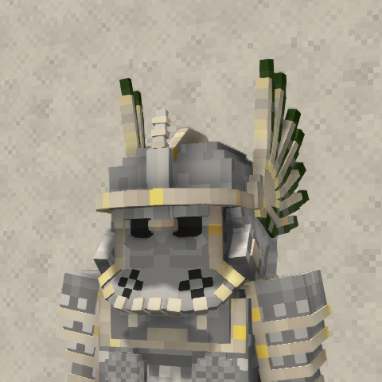
            </a>
            <figcaption>Communis-Pennae</figcaption>
          </figure>
          <figure class="hussar-card">
            <a href="images/szyszak-masked-helmet/communis/pluma.png">
              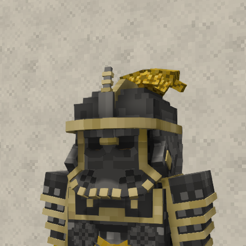
            </a>
            <figcaption>Communis-Pluma</figcaption>
          </figure>
          <figure class="hussar-card">
            <a href="images/szyszak-masked-helmet/communis/crista.png">
              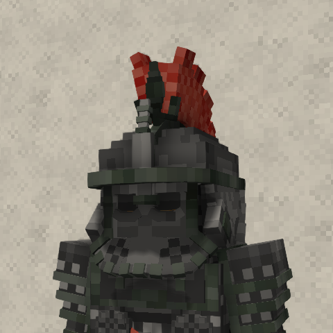
            </a>
            <figcaption>Communis-Crista</figcaption>
          </figure>
          <figure class="hussar-card">
            <a href="images/szyszak-masked-helmet/communis/pinna.png">
              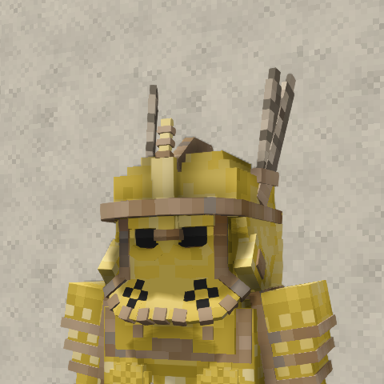
            </a>
            <figcaption>Communis-Pinna</figcaption>
          </figure>
          <figure class="hussar-card">
            <a href="images/szyszak-masked-helmet/communis/sertum.png">
              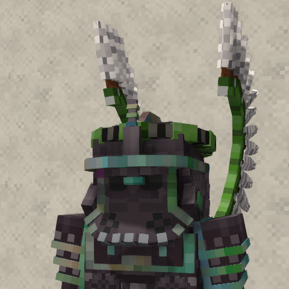
            </a>
            <figcaption>Communis-Sertum</figcaption>
          </figure>
          <figure class="hussar-card">
            <a href="images/szyszak-masked-helmet/communis/transversa.png">
              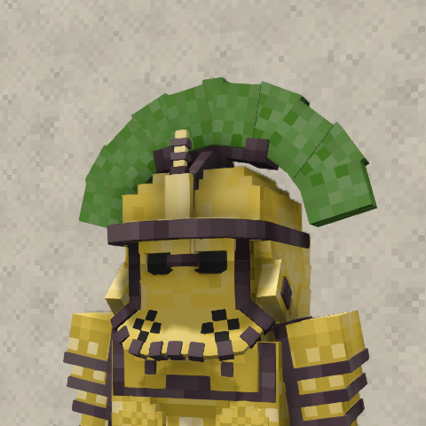
            </a>
            <figcaption>Communis-Transversa</figcaption>
          </figure>
          <figure class="hussar-card">
            <a href="images/szyszak-masked-helmet/communis/statua.png">
              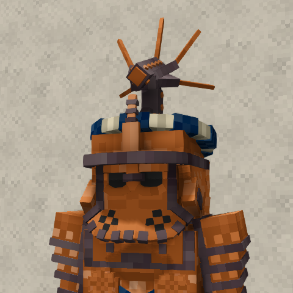
            </a>
            <figcaption>Communis-Statua</figcaption>
          </figure>
          <figure class="hussar-card">
            <a href="images/szyszak-masked-helmet/communis/cauda.png">
              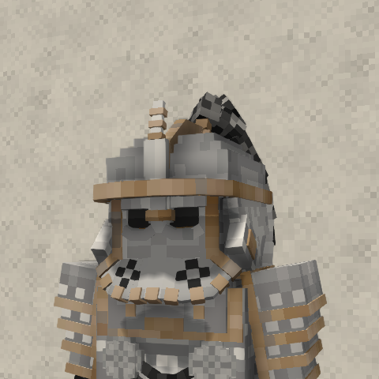
            </a>
            <figcaption>Communis-Cauda</figcaption>
          </figure>

        <figure class="hussar-card">
            
            <figcaption>Communis-Laurea</figcaption>
          </figure>
        <figure class="hussar-card">
            
            <figcaption>Communis-Corona</figcaption>
          </figure>
        <figure class="hussar-card">
            
            <figcaption>Communis-Cervinus</figcaption>
          </figure>
        <figure class="hussar-card">
            
            <figcaption>Communis-Arietinus</figcaption>
          </figure>
        <figure class="hussar-card">
            
            <figcaption>Communis-Taurinus</figcaption>
          </figure>
    <figure class="hussar-card">
            <a href="images/szyszak-masked-helmet/animal/bear.png">
              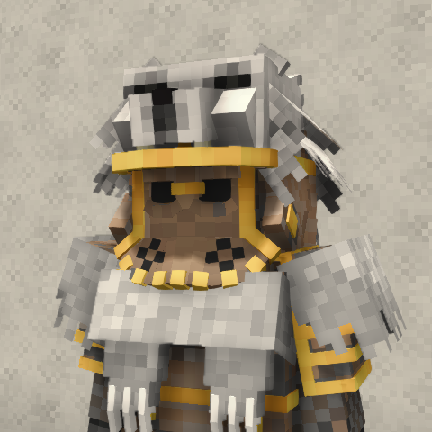
            </a>
            <figcaption>Animal-Bear</figcaption>
          </figure>
          <figure class="hussar-card">
            <a href="images/szyszak-masked-helmet/animal/wolf.png">
              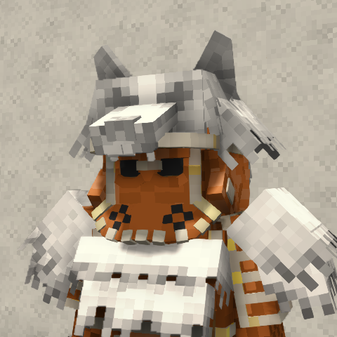
            </a>
            <figcaption>Animal-Wolf</figcaption>
          </figure>
    

  

  

    <h3>Regalis</h3>
    

          <figure class="hussar-card">
            <a href="images/szyszak-masked-helmet/regalis/crista.png">
              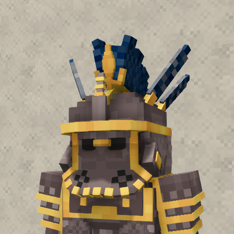
            </a>
            <figcaption>Regalis-Crista</figcaption>
          </figure>
          <figure class="hussar-card">
            
            <figcaption>Regalis-Transversa</figcaption>
          </figure>
          <figure class="hussar-card">
            
            <figcaption>Regalis-Pennae</figcaption>
          </figure>
          <figure class="hussar-card">
            
            <figcaption>Regalis-Pinna</figcaption>
          </figure>
          <figure class="hussar-card">
            
            <figcaption>Regalis-Pluma</figcaption>
          </figure>
          <figure class="hussar-card">
            
            <figcaption>Regalis-Sertum</figcaption>
          </figure>
          <figure class="hussar-card">
            
            <figcaption>Regalis-Statua</figcaption>
          </figure>
          <figure class="hussar-card">
            
            <figcaption>Regalis-Cauda</figcaption>
          </figure>

        <figure class="hussar-card">
            
            <figcaption>Regalis-Laurea</figcaption>
          </figure>
        <figure class="hussar-card">
            
            <figcaption>Regalis-Corona</figcaption>
          </figure>
        <figure class="hussar-card">
            
            <figcaption>Regalis-Cervinus</figcaption>
          </figure>
        <figure class="hussar-card">
            
            <figcaption>Regalis-Arietinus</figcaption>
          </figure>
        <figure class="hussar-card">
            
            <figcaption>Regalis-Taurinus</figcaption>
          </figure>
    

  

  

    <h3>Metallicus</h3>
    

          <figure class="hussar-card">
            
            <figcaption>Metallicus-Laurea</figcaption>
          </figure>
          <figure class="hussar-card">
            
            <figcaption>Metallicus-Corona</figcaption>
          </figure>
          <figure class="hussar-card">
            
            <figcaption>Metallicus-Cervinus</figcaption>
          </figure>
          <figure class="hussar-card">
            
            <figcaption>Metallicus-Arietinus</figcaption>
          </figure>
          <figure class="hussar-card">
            
            <figcaption>Metallicus-Taurinus</figcaption>
          </figure>
    
<figure class="hussar-card">
            
            <figcaption>Metallicus-Statua</figcaption>
          </figure>

  

  </section>
<section id="dragoon-chestplate" class="hussar-section" aria-labelledby="dragoon-chestplate-title">
  <h2 id="dragoon-chestplate-title">Dragoon — Body brackets</h2>
  
Decoration variants.

  

    <h3>Brackets</h3>
    

          <figure class="hussar-card">
            
            <figcaption>Brackets-Insignia</figcaption>
          </figure>
          <figure class="hussar-card">
            
            <figcaption>Brackets-Pectorale</figcaption>
          </figure>
          <figure class="hussar-card">
            
            <figcaption>Brackets-Cingulum</figcaption>
          </figure>
          <figure class="hussar-card">
            
            <figcaption>Brackets-Mantellum</figcaption>
          </figure>
          <figure class="hussar-card">
            
            <figcaption>Brackets-Vexillum</figcaption>
          </figure>
          <figure class="hussar-card">
            
            <figcaption>Brackets-Balterus</figcaption>
          </figure>
    <figure class="hussar-card">
            
            <figcaption>Animal-Bear</figcaption>
          </figure>
          <figure class="hussar-card">
            
            <figcaption>Animal-Wolf</figcaption>
          </figure>
    

  

  </section>
<section id="dragoon-legplate" class="hussar-section" aria-labelledby="dragoon-legplate-title">
  <h2 id="dragoon-legplate-title">Dragoon — Legs fasteners</h2>
  
Decoration variants.

  

    <h3>Fasteners</h3>
    

          <figure class="hussar-card">
            
            <figcaption>Lacinia</figcaption>
          </figure>
          <figure class="hussar-card">
            
            <figcaption>Genuale</figcaption>
          </figure>
          <figure class="hussar-card">
            
            <figcaption>Falda</figcaption>
          </figure>
    <figure class="hussar-card">
            
            <figcaption>Animal-Bear</figcaption>
          </figure>
          <figure class="hussar-card">
            
            <figcaption>Animal-Wolf</figcaption>
          </figure>
    

  

  </section>

<section id="kapalin-helmet" class="hussar-section" aria-labelledby="kapalin-helmet-title">
  <h2 id="kapalin-helmet-title">Kapalin — Head ornaments</h2>
  
Decoration variants.

  

    <h3>Communis</h3>
    

          <figure class="hussar-card">
            
            <figcaption>Communis-Pennae</figcaption>
          </figure>
          <figure class="hussar-card">
            
            <figcaption>Communis-Pluma</figcaption>
          </figure>
          <figure class="hussar-card">
            
            <figcaption>Communis-Crista</figcaption>
          </figure>
          <figure class="hussar-card">
            
            <figcaption>Communis-Pinna</figcaption>
          </figure>
          <figure class="hussar-card">
            
            <figcaption>Communis-Sertum</figcaption>
          </figure>
          <figure class="hussar-card">
            
            <figcaption>Communis-Transversa</figcaption>
          </figure>
          <figure class="hussar-card">
            
            <figcaption>Communis-Statua</figcaption>
          </figure>
          <figure class="hussar-card">
            
            <figcaption>Communis-Cauda</figcaption>
          </figure>

        <figure class="hussar-card">
            
            <figcaption>Communis-Laurea</figcaption>
          </figure>
        <figure class="hussar-card">
            
            <figcaption>Communis-Corona</figcaption>
          </figure>
        <figure class="hussar-card">
            
            <figcaption>Communis-Cervinus</figcaption>
          </figure>
        <figure class="hussar-card">
            
            <figcaption>Communis-Arietinus</figcaption>
          </figure>
        <figure class="hussar-card">
            
            <figcaption>Communis-Taurinus</figcaption>
          </figure>
    <figure class="hussar-card">
            
            <figcaption>Animal-Bear</figcaption>
          </figure>
          <figure class="hussar-card">
            
            <figcaption>Animal-Wolf</figcaption>
          </figure>
    

  

  

    <h3>Regalis</h3>
    

          <figure class="hussar-card">
            
            <figcaption>Regalis-Crista</figcaption>
          </figure>
          <figure class="hussar-card">
            
            <figcaption>Regalis-Transversa</figcaption>
          </figure>
          <figure class="hussar-card">
            
            <figcaption>Regalis-Pennae</figcaption>
          </figure>
          <figure class="hussar-card">
            
            <figcaption>Regalis-Pinna</figcaption>
          </figure>
          <figure class="hussar-card">
            
            <figcaption>Regalis-Pluma</figcaption>
          </figure>
          <figure class="hussar-card">
            
            <figcaption>Regalis-Sertum</figcaption>
          </figure>
          <figure class="hussar-card">
            
            <figcaption>Regalis-Statua</figcaption>
          </figure>
          <figure class="hussar-card">
            
            <figcaption>Regalis-Cauda</figcaption>
          </figure>

        <figure class="hussar-card">
            
            <figcaption>Regalis-Laurea</figcaption>
          </figure>
        <figure class="hussar-card">
            
            <figcaption>Regalis-Corona</figcaption>
          </figure>
        <figure class="hussar-card">
            
            <figcaption>Regalis-Cervinus</figcaption>
          </figure>
        <figure class="hussar-card">
            
            <figcaption>Regalis-Arietinus</figcaption>
          </figure>
        <figure class="hussar-card">
            
            <figcaption>Regalis-Taurinus</figcaption>
          </figure>
    

  

  

    <h3>Metallicus</h3>
    

          <figure class="hussar-card">
            
            <figcaption>Metallicus-Laurea</figcaption>
          </figure>
          <figure class="hussar-card">
            
            <figcaption>Metallicus-Corona</figcaption>
          </figure>
          <figure class="hussar-card">
            
            <figcaption>Metallicus-Cervinus</figcaption>
          </figure>
          <figure class="hussar-card">
            
            <figcaption>Metallicus-Arietinus</figcaption>
          </figure>
          <figure class="hussar-card">
            
            <figcaption>Metallicus-Taurinus</figcaption>
          </figure>
    
<figure class="hussar-card">
            
            <figcaption>Metallicus-Statua</figcaption>
          </figure>

  

  </section>
<section id="kapalin-covered-helmet" class="hussar-section" aria-labelledby="kapalin-covered-helmet-title">
  <h2 id="kapalin-covered-helmet-title">Kapalin Covered — Head ornaments</h2>
  
Decoration variants.

  

    <h3>Communis</h3>
    

          <figure class="hussar-card">
            
            <figcaption>Communis-Pennae</figcaption>
          </figure>
          <figure class="hussar-card">
            
            <figcaption>Communis-Pluma</figcaption>
          </figure>
          <figure class="hussar-card">
            
            <figcaption>Communis-Crista</figcaption>
          </figure>
          <figure class="hussar-card">
            
            <figcaption>Communis-Pinna</figcaption>
          </figure>
          <figure class="hussar-card">
            
            <figcaption>Communis-Sertum</figcaption>
          </figure>
          <figure class="hussar-card">
            
            <figcaption>Communis-Transversa</figcaption>
          </figure>
          <figure class="hussar-card">
            
            <figcaption>Communis-Statua</figcaption>
          </figure>
          <figure class="hussar-card">
            
            <figcaption>Communis-Cauda</figcaption>
          </figure>

        <figure class="hussar-card">
            
            <figcaption>Communis-Laurea</figcaption>
          </figure>
        <figure class="hussar-card">
            
            <figcaption>Communis-Corona</figcaption>
          </figure>
        <figure class="hussar-card">
            
            <figcaption>Communis-Cervinus</figcaption>
          </figure>
        <figure class="hussar-card">
            
            <figcaption>Communis-Arietinus</figcaption>
          </figure>
        <figure class="hussar-card">
            
            <figcaption>Communis-Taurinus</figcaption>
          </figure>
    <figure class="hussar-card">
            
            <figcaption>Animal-Bear</figcaption>
          </figure>
          <figure class="hussar-card">
            
            <figcaption>Animal-Wolf</figcaption>
          </figure>
    

  

  

    <h3>Regalis</h3>
    

          <figure class="hussar-card">
            
            <figcaption>Regalis-Crista</figcaption>
          </figure>
          <figure class="hussar-card">
            
            <figcaption>Regalis-Transversa</figcaption>
          </figure>
          <figure class="hussar-card">
            
            <figcaption>Regalis-Pennae</figcaption>
          </figure>
          <figure class="hussar-card">
            
            <figcaption>Regalis-Pinna</figcaption>
          </figure>
          <figure class="hussar-card">
            
            <figcaption>Regalis-Pluma</figcaption>
          </figure>
          <figure class="hussar-card">
            
            <figcaption>Regalis-Sertum</figcaption>
          </figure>
          <figure class="hussar-card">
            
            <figcaption>Regalis-Statua</figcaption>
          </figure>
          <figure class="hussar-card">
            
            <figcaption>Regalis-Cauda</figcaption>
          </figure>

        <figure class="hussar-card">
            
            <figcaption>Regalis-Laurea</figcaption>
          </figure>
        <figure class="hussar-card">
            
            <figcaption>Regalis-Corona</figcaption>
          </figure>
        <figure class="hussar-card">
            
            <figcaption>Regalis-Cervinus</figcaption>
          </figure>
        <figure class="hussar-card">
            
            <figcaption>Regalis-Arietinus</figcaption>
          </figure>
        <figure class="hussar-card">
            
            <figcaption>Regalis-Taurinus</figcaption>
          </figure>
    

  

  

    <h3>Metallicus</h3>
    

          <figure class="hussar-card">
            
            <figcaption>Metallicus-Laurea</figcaption>
          </figure>
          <figure class="hussar-card">
            
            <figcaption>Metallicus-Corona</figcaption>
          </figure>
          <figure class="hussar-card">
            
            <figcaption>Metallicus-Cervinus</figcaption>
          </figure>
          <figure class="hussar-card">
            
            <figcaption>Metallicus-Arietinus</figcaption>
          </figure>
          <figure class="hussar-card">
            
            <figcaption>Metallicus-Taurinus</figcaption>
          </figure>
    
<figure class="hussar-card">
            
            <figcaption>Metallicus-Statua</figcaption>
          </figure>

  

  </section>
<section id="kapalin-masked-helmet" class="hussar-section" aria-labelledby="kapalin-masked-helmet-title">
  <h2 id="kapalin-masked-helmet-title">Kapalin Masked — Head ornaments</h2>
  
Decoration variants.

  

    <h3>Communis</h3>
    

          <figure class="hussar-card">
            
            <figcaption>Communis-Pennae</figcaption>
          </figure>
          <figure class="hussar-card">
            
            <figcaption>Communis-Pluma</figcaption>
          </figure>
          <figure class="hussar-card">
            
            <figcaption>Communis-Crista</figcaption>
          </figure>
          <figure class="hussar-card">
            
            <figcaption>Communis-Pinna</figcaption>
          </figure>
          <figure class="hussar-card">
            
            <figcaption>Communis-Sertum</figcaption>
          </figure>
          <figure class="hussar-card">
            
            <figcaption>Communis-Transversa</figcaption>
          </figure>
          <figure class="hussar-card">
            
            <figcaption>Communis-Statua</figcaption>
          </figure>
          <figure class="hussar-card">
            
            <figcaption>Communis-Cauda</figcaption>
          </figure>

        <figure class="hussar-card">
            
            <figcaption>Communis-Laurea</figcaption>
          </figure>
        <figure class="hussar-card">
            
            <figcaption>Communis-Corona</figcaption>
          </figure>
        <figure class="hussar-card">
            
            <figcaption>Communis-Cervinus</figcaption>
          </figure>
        <figure class="hussar-card">
            
            <figcaption>Communis-Arietinus</figcaption>
          </figure>
        <figure class="hussar-card">
            
            <figcaption>Communis-Taurinus</figcaption>
          </figure>
    <figure class="hussar-card">
            
            <figcaption>Animal-Bear</figcaption>
          </figure>
          <figure class="hussar-card">
            
            <figcaption>Animal-Wolf</figcaption>
          </figure>
    

  

  

    <h3>Regalis</h3>
    

          <figure class="hussar-card">
            
            <figcaption>Regalis-Crista</figcaption>
          </figure>
          <figure class="hussar-card">
            
            <figcaption>Regalis-Transversa</figcaption>
          </figure>
          <figure class="hussar-card">
            
            <figcaption>Regalis-Pennae</figcaption>
          </figure>
          <figure class="hussar-card">
            
            <figcaption>Regalis-Pinna</figcaption>
          </figure>
          <figure class="hussar-card">
            
            <figcaption>Regalis-Pluma</figcaption>
          </figure>
          <figure class="hussar-card">
            
            <figcaption>Regalis-Sertum</figcaption>
          </figure>
          <figure class="hussar-card">
            
            <figcaption>Regalis-Statua</figcaption>
          </figure>
          <figure class="hussar-card">
            
            <figcaption>Regalis-Cauda</figcaption>
          </figure>

        <figure class="hussar-card">
            
            <figcaption>Regalis-Laurea</figcaption>
          </figure>
        <figure class="hussar-card">
            
            <figcaption>Regalis-Corona</figcaption>
          </figure>
        <figure class="hussar-card">
            
            <figcaption>Regalis-Cervinus</figcaption>
          </figure>
        <figure class="hussar-card">
            
            <figcaption>Regalis-Arietinus</figcaption>
          </figure>
        <figure class="hussar-card">
            
            <figcaption>Regalis-Taurinus</figcaption>
          </figure>
    

  

  

    <h3>Metallicus</h3>
    

          <figure class="hussar-card">
            
            <figcaption>Metallicus-Laurea</figcaption>
          </figure>
          <figure class="hussar-card">
            
            <figcaption>Metallicus-Corona</figcaption>
          </figure>
          <figure class="hussar-card">
            
            <figcaption>Metallicus-Cervinus</figcaption>
          </figure>
          <figure class="hussar-card">
            
            <figcaption>Metallicus-Arietinus</figcaption>
          </figure>
          <figure class="hussar-card">
            
            <figcaption>Metallicus-Taurinus</figcaption>
          </figure>
    
<figure class="hussar-card">
            
            <figcaption>Metallicus-Statua</figcaption>
          </figure>

  

  </section>
  <section id="cavalier-chestplate" class="hussar-section" aria-labelledby="cavalier-chestplate-title">
  <h2 id="cavalier-chestplate-title">Cavalier — Body brackets</h2>
  
Decoration variants.

  

    <h3>Brackets</h3>
    

          <figure class="hussar-card">
            
            <figcaption>Brackets-Insignia</figcaption>
          </figure>
          <figure class="hussar-card">
            
            <figcaption>Brackets-Pectorale</figcaption>
          </figure>
          <figure class="hussar-card">
            
            <figcaption>Brackets-Cingulum</figcaption>
          </figure>
          <figure class="hussar-card">
            
            <figcaption>Brackets-Mantellum</figcaption>
          </figure>
          <figure class="hussar-card">
            
            <figcaption>Brackets-Vexillum</figcaption>
          </figure>
          <figure class="hussar-card">
            
            <figcaption>Brackets-Balterus</figcaption>
          </figure>
    <figure class="hussar-card">
            
            <figcaption>Animal-Bear</figcaption>
          </figure>
          <figure class="hussar-card">
            
            <figcaption>Animal-Wolf</figcaption>
          </figure>
    

  

  </section>
  <section id="cavalier-legplate" class="hussar-section" aria-labelledby="cavalier-legplate-title">
  <h2 id="cavalier-legplate-title">Cavalier — Legs fasteners</h2>
  
Decoration variants.

  

    <h3>Fasteners</h3>
    

          <figure class="hussar-card">
            
            <figcaption>Lacinia</figcaption>
          </figure>
          <figure class="hussar-card">
            
            <figcaption>Genuale</figcaption>
          </figure>
          <figure class="hussar-card">
            
            <figcaption>Falda</figcaption>
          </figure>
    <figure class="hussar-card">
            
            <figcaption>Animal-Bear</figcaption>
          </figure>
          <figure class="hussar-card">
            
            <figcaption>Animal-Wolf</figcaption>
          </figure>
    

  

  </section>
<section id="poses" class="hussar-section fa-poses" aria-labelledby="poses-title"><h2 id="poses-title">Poses</h2><section class="fa-pose-set" id="dragoon-poses"><h3 id="dragoon-poses-title">Dragoon set</h3>
<figure class="hussar-card">
            
            <figcaption>Dragoon — Iron — Pose 1</figcaption>
          </figure>
          <figure class="hussar-card">
            
            <figcaption>Dragoon — Iron — Pose 2</figcaption>
          </figure>
        <figure class="hussar-card">
            
            <figcaption>Dragoon — Meteoric Iron — Pose 1</figcaption>
          </figure>
          <figure class="hussar-card">
            
            <figcaption>Dragoon — Meteoric Iron — Pose 2</figcaption>
          </figure>
        <figure class="hussar-card">
            
            <figcaption>Dragoon — Steel — Pose 1</figcaption>
          </figure>
          <figure class="hussar-card">
            
            <figcaption>Dragoon — Steel — Pose 2</figcaption>
          </figure>
        
</section><section class="fa-pose-set" id="cavalier-poses"><h3 id="cavalier-poses-title">Cavalier set</h3>
<figure class="hussar-card">
            
            <figcaption>Cavalier — Iron — Pose 1</figcaption>
          </figure>
          <figure class="hussar-card">
            
            <figcaption>Cavalier — Iron — Pose 2</figcaption>
          </figure>
        <figure class="hussar-card">
            
            <figcaption>Cavalier — Meteoric Iron — Pose 1</figcaption>
          </figure>
          <figure class="hussar-card">
            
            <figcaption>Cavalier — Meteoric Iron — Pose 2</figcaption>
          </figure>
        <figure class="hussar-card">
            
            <figcaption>Cavalier — Steel — Pose 1</figcaption>
          </figure>
          <figure class="hussar-card">
            
            <figcaption>Cavalier — Steel — Pose 2</figcaption>
          </figure>
        
</section></section>

  <section class="note">

    
Return to the full Forgotten Armory directory.

    <a href="{{ '/vintage-story/forgotten-armory/' | relative_url }}">Forgotten Armory ←</a>
  
</section>
  <section class="note">

    
Find Aladar’s mods on Vintage Story ModDB.

    <a href="https://mods.vintagestory.at/show/user/922a98ad603bda6d92eb">All mods on ModDB ↗</a>
  
</section>

