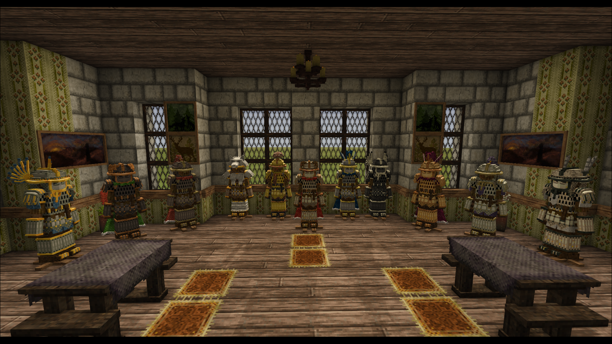

<link rel="stylesheet" href="{{ '/vintage-story/forgotten-armory/hussar/hussar.css' | relative_url }}">

<a href="{{ '/vintage-story/forgotten-armory/' | relative_url }}">← Forgotten Armory</a>

<header class="hussar-hero">
FORGOTTEN ARMORY · COLLECTION
<h1>Hussar</h1>
Dragoon and Cavalier sets, decorations and material poses.
</header>
<nav class="hussar-navigation" aria-label="Hussar sections"><a href="#introduction">Introduction</a><a href="#szyszak-helmet">Szyszak helmet</a><a href="#szyszak-covered-helmet">Szyszak covered helmet</a><a href="#szyszak-masked-helmet">Szyszak masked helmet</a><a href="#kapalin-helmet">Kapalin helmet</a><a href="#kapalin-covered-helmet">Kapalin covered helmet</a><a href="#kapalin-masked-helmet">Kapalin masked helmet</a><a href="#dragoon-chestplate">Dragoon chestplate</a><a href="#dragoon-legplate">Dragoon legplate</a><a href="#cavalier-chestplate">Cavalier chestplate</a><a href="#cavalier-legplate">Cavalier legplate</a><a href="#poses">Poses</a></nav>
<section id="introduction" class="hussar-section" aria-labelledby="introduction-title"><h2 id="introduction-title">Introduction</h2>
Decoration images are shown where available; missing variants use placeholders. Wideshots are temporary references.

<figure class="hussar-card" id="captain-set">
            
            <figcaption>Dragoon set</figcaption>
          </figure>
          <figure class="hussar-card" id="guard-set">
            
            <figcaption>Cavalier set</figcaption>
          </figure>
          
</section>
<section id="szyszak-helmet" class="hussar-section" aria-labelledby="szyszak-helmet-title">
  <h2 id="szyszak-helmet-title">Szyszak Helmet decorations</h2>
  
Decoration variants.

  

    <h3>Communis</h3>
    

          <figure class="hussar-card">
            
            <figcaption>Communis-Pennae</figcaption>
          </figure>
          <figure class="hussar-card">
            
            <figcaption>Communis-Pluma</figcaption>
          </figure>
          <figure class="hussar-card">
            
            <figcaption>Communis-Crista</figcaption>
          </figure>
          <figure class="hussar-card">
            
            <figcaption>Communis-Pinna</figcaption>
          </figure>
          <figure class="hussar-card">
            
            <figcaption>Communis-Sertum</figcaption>
          </figure>
          <figure class="hussar-card">
            
            <figcaption>Communis-Transversa</figcaption>
          </figure>
          <figure class="hussar-card">
            
            <figcaption>Communis-Vexillum</figcaption>
          </figure>
          <figure class="hussar-card">
            
            <figcaption>Communis-Cauda</figcaption>
          </figure>

        <figure class="hussar-card">
            
            <figcaption>Communis-Laurea</figcaption>
          </figure>
        <figure class="hussar-card">
            
            <figcaption>Communis-Corona</figcaption>
          </figure>
        <figure class="hussar-card">
            
            <figcaption>Communis-Cervinus</figcaption>
          </figure>
        <figure class="hussar-card">
            
            <figcaption>Communis-Arietinus</figcaption>
          </figure>
        <figure class="hussar-card">
            
            <figcaption>Communis-Taurinus</figcaption>
          </figure>
    

  

  

    <h3>Regalis</h3>
    

          <figure class="hussar-card">
            
            <figcaption>Regalis-Crista</figcaption>
          </figure>
          <figure class="hussar-card">
            
            <figcaption>Regalis-Transversa</figcaption>
          </figure>
          <figure class="hussar-card">
            
            <figcaption>Regalis-Pennae</figcaption>
          </figure>
          <figure class="hussar-card">
            
            <figcaption>Regalis-Pinna</figcaption>
          </figure>
          <figure class="hussar-card">
            
            <figcaption>Regalis-Pluma</figcaption>
          </figure>
          <figure class="hussar-card">
            
            <figcaption>Regalis-Sertum</figcaption>
          </figure>
          <figure class="hussar-card">
            
            <figcaption>Regalis-Vexillum</figcaption>
          </figure>
          <figure class="hussar-card">
            
            <figcaption>Regalis-Cauda</figcaption>
          </figure>

        <figure class="hussar-card">
            
            <figcaption>Regalis-Laurea</figcaption>
          </figure>
        <figure class="hussar-card">
            
            <figcaption>Regalis-Corona</figcaption>
          </figure>
        <figure class="hussar-card">
            
            <figcaption>Regalis-Cervinus</figcaption>
          </figure>
        <figure class="hussar-card">
            
            <figcaption>Regalis-Arietinus</figcaption>
          </figure>
        <figure class="hussar-card">
            
            <figcaption>Regalis-Taurinus</figcaption>
          </figure>
    

  

  

    <h3>Metallicus</h3>
    

          <figure class="hussar-card">
            
            <figcaption>Metallicus-Laurea</figcaption>
          </figure>
          <figure class="hussar-card">
            
            <figcaption>Metallicus-Corona</figcaption>
          </figure>
          <figure class="hussar-card">
            
            <figcaption>Metallicus-Cervinus</figcaption>
          </figure>
          <figure class="hussar-card">
            
            <figcaption>Metallicus-Arietinus</figcaption>
          </figure>
          <figure class="hussar-card">
            
            <figcaption>Metallicus-Taurinus</figcaption>
          </figure>
    

  

  

    <h3>Animal</h3>
    

          <figure class="hussar-card">
            
            <figcaption>Animal-Bear</figcaption>
          </figure>
          <figure class="hussar-card">
            
            <figcaption>Animal-Wolf</figcaption>
          </figure>
    

  

</section>
<section id="szyszak-covered-helmet" class="hussar-section" aria-labelledby="szyszak-covered-helmet-title">
  <h2 id="szyszak-covered-helmet-title">Szyszak Covered Helmet decorations</h2>
  
Decoration variants.

  

    <h3>Communis</h3>
    

          <figure class="hussar-card">
            
            <figcaption>Communis-Pennae</figcaption>
          </figure>
          <figure class="hussar-card">
            
            <figcaption>Communis-Pluma</figcaption>
          </figure>
          <figure class="hussar-card">
            
            <figcaption>Communis-Crista</figcaption>
          </figure>
          <figure class="hussar-card">
            
            <figcaption>Communis-Pinna</figcaption>
          </figure>
          <figure class="hussar-card">
            
            <figcaption>Communis-Sertum</figcaption>
          </figure>
          <figure class="hussar-card">
            
            <figcaption>Communis-Transversa</figcaption>
          </figure>
          <figure class="hussar-card">
            
            <figcaption>Communis-Vexillum</figcaption>
          </figure>
          <figure class="hussar-card">
            
            <figcaption>Communis-Cauda</figcaption>
          </figure>

        <figure class="hussar-card">
            
            <figcaption>Communis-Laurea</figcaption>
          </figure>
        <figure class="hussar-card">
            
            <figcaption>Communis-Corona</figcaption>
          </figure>
        <figure class="hussar-card">
            
            <figcaption>Communis-Cervinus</figcaption>
          </figure>
        <figure class="hussar-card">
            
            <figcaption>Communis-Arietinus</figcaption>
          </figure>
        <figure class="hussar-card">
            
            <figcaption>Communis-Taurinus</figcaption>
          </figure>
    

  

  

    <h3>Regalis</h3>
    

          <figure class="hussar-card">
            
            <figcaption>Regalis-Crista</figcaption>
          </figure>
          <figure class="hussar-card">
            
            <figcaption>Regalis-Transversa</figcaption>
          </figure>
          <figure class="hussar-card">
            
            <figcaption>Regalis-Pennae</figcaption>
          </figure>
          <figure class="hussar-card">
            
            <figcaption>Regalis-Pinna</figcaption>
          </figure>
          <figure class="hussar-card">
            
            <figcaption>Regalis-Pluma</figcaption>
          </figure>
          <figure class="hussar-card">
            
            <figcaption>Regalis-Sertum</figcaption>
          </figure>
          <figure class="hussar-card">
            
            <figcaption>Regalis-Vexillum</figcaption>
          </figure>
          <figure class="hussar-card">
            
            <figcaption>Regalis-Cauda</figcaption>
          </figure>

        <figure class="hussar-card">
            
            <figcaption>Regalis-Laurea</figcaption>
          </figure>
        <figure class="hussar-card">
            
            <figcaption>Regalis-Corona</figcaption>
          </figure>
        <figure class="hussar-card">
            
            <figcaption>Regalis-Cervinus</figcaption>
          </figure>
        <figure class="hussar-card">
            
            <figcaption>Regalis-Arietinus</figcaption>
          </figure>
        <figure class="hussar-card">
            
            <figcaption>Regalis-Taurinus</figcaption>
          </figure>
    

  

  

    <h3>Metallicus</h3>
    

          <figure class="hussar-card">
            
            <figcaption>Metallicus-Laurea</figcaption>
          </figure>
          <figure class="hussar-card">
            
            <figcaption>Metallicus-Corona</figcaption>
          </figure>
          <figure class="hussar-card">
            
            <figcaption>Metallicus-Cervinus</figcaption>
          </figure>
          <figure class="hussar-card">
            
            <figcaption>Metallicus-Arietinus</figcaption>
          </figure>
          <figure class="hussar-card">
            
            <figcaption>Metallicus-Taurinus</figcaption>
          </figure>
    

  

  

    <h3>Animal</h3>
    

          <figure class="hussar-card">
            
            <figcaption>Animal-Bear</figcaption>
          </figure>
          <figure class="hussar-card">
            
            <figcaption>Animal-Wolf</figcaption>
          </figure>
    

  

</section>
<section id="szyszak-masked-helmet" class="hussar-section" aria-labelledby="szyszak-masked-helmet-title">
  <h2 id="szyszak-masked-helmet-title">Szyszak Masked Helmet decorations</h2>
  
Decoration variants.

  

    <h3>Communis</h3>
    

          <figure class="hussar-card">
            
            <figcaption>Communis-Pennae</figcaption>
          </figure>
          <figure class="hussar-card">
            
            <figcaption>Communis-Pluma</figcaption>
          </figure>
          <figure class="hussar-card">
            
            <figcaption>Communis-Crista</figcaption>
          </figure>
          <figure class="hussar-card">
            
            <figcaption>Communis-Pinna</figcaption>
          </figure>
          <figure class="hussar-card">
            
            <figcaption>Communis-Sertum</figcaption>
          </figure>
          <figure class="hussar-card">
            
            <figcaption>Communis-Transversa</figcaption>
          </figure>
          <figure class="hussar-card">
            
            <figcaption>Communis-Vexillum</figcaption>
          </figure>
          <figure class="hussar-card">
            
            <figcaption>Communis-Cauda</figcaption>
          </figure>

        <figure class="hussar-card">
            
            <figcaption>Communis-Laurea</figcaption>
          </figure>
        <figure class="hussar-card">
            
            <figcaption>Communis-Corona</figcaption>
          </figure>
        <figure class="hussar-card">
            
            <figcaption>Communis-Cervinus</figcaption>
          </figure>
        <figure class="hussar-card">
            
            <figcaption>Communis-Arietinus</figcaption>
          </figure>
        <figure class="hussar-card">
            
            <figcaption>Communis-Taurinus</figcaption>
          </figure>
    

  

  

    <h3>Regalis</h3>
    

          <figure class="hussar-card">
            
            <figcaption>Regalis-Crista</figcaption>
          </figure>
          <figure class="hussar-card">
            
            <figcaption>Regalis-Transversa</figcaption>
          </figure>
          <figure class="hussar-card">
            
            <figcaption>Regalis-Pennae</figcaption>
          </figure>
          <figure class="hussar-card">
            
            <figcaption>Regalis-Pinna</figcaption>
          </figure>
          <figure class="hussar-card">
            
            <figcaption>Regalis-Pluma</figcaption>
          </figure>
          <figure class="hussar-card">
            
            <figcaption>Regalis-Sertum</figcaption>
          </figure>
          <figure class="hussar-card">
            
            <figcaption>Regalis-Vexillum</figcaption>
          </figure>
          <figure class="hussar-card">
            
            <figcaption>Regalis-Cauda</figcaption>
          </figure>

        <figure class="hussar-card">
            
            <figcaption>Regalis-Laurea</figcaption>
          </figure>
        <figure class="hussar-card">
            
            <figcaption>Regalis-Corona</figcaption>
          </figure>
        <figure class="hussar-card">
            
            <figcaption>Regalis-Cervinus</figcaption>
          </figure>
        <figure class="hussar-card">
            
            <figcaption>Regalis-Arietinus</figcaption>
          </figure>
        <figure class="hussar-card">
            
            <figcaption>Regalis-Taurinus</figcaption>
          </figure>
    

  

  

    <h3>Metallicus</h3>
    

          <figure class="hussar-card">
            
            <figcaption>Metallicus-Laurea</figcaption>
          </figure>
          <figure class="hussar-card">
            
            <figcaption>Metallicus-Corona</figcaption>
          </figure>
          <figure class="hussar-card">
            
            <figcaption>Metallicus-Cervinus</figcaption>
          </figure>
          <figure class="hussar-card">
            
            <figcaption>Metallicus-Arietinus</figcaption>
          </figure>
          <figure class="hussar-card">
            
            <figcaption>Metallicus-Taurinus</figcaption>
          </figure>
    

  

  

    <h3>Animal</h3>
    

          <figure class="hussar-card">
            
            <figcaption>Animal-Bear</figcaption>
          </figure>
          <figure class="hussar-card">
            
            <figcaption>Animal-Wolf</figcaption>
          </figure>
    

  

</section>
<section id="dragoon-chestplate" class="hussar-section" aria-labelledby="dragoon-chestplate-title">
  <h2 id="dragoon-chestplate-title">Dragoon Chestplate decorations</h2>
  
Decoration variants.

  

    <h3>Brackets</h3>
    

          <figure class="hussar-card">
            
            <figcaption>Brackets-Insignia</figcaption>
          </figure>
          <figure class="hussar-card">
            
            <figcaption>Brackets-Pectorale</figcaption>
          </figure>
          <figure class="hussar-card">
            
            <figcaption>Brackets-Cingulum</figcaption>
          </figure>
          <figure class="hussar-card">
            
            <figcaption>Brackets-Mantellum</figcaption>
          </figure>
          <figure class="hussar-card">
            
            <figcaption>Brackets-Vexilium</figcaption>
          </figure>
          <figure class="hussar-card">
            
            <figcaption>Brackets-Balterus</figcaption>
          </figure>
    

  

  

    <h3>Animal</h3>
    

          <figure class="hussar-card">
            
            <figcaption>Animal-Bear</figcaption>
          </figure>
          <figure class="hussar-card">
            
            <figcaption>Animal-Wolf</figcaption>
          </figure>
    

  

</section>
<section id="dragoon-legplate" class="hussar-section" aria-labelledby="dragoon-legplate-title">
  <h2 id="dragoon-legplate-title">Dragoon Legplate decorations</h2>
  
Decoration variants.

  

    <h3>Decorations</h3>
    

          <figure class="hussar-card">
            
            <figcaption>Lacinia</figcaption>
          </figure>
          <figure class="hussar-card">
            
            <figcaption>Genuale</figcaption>
          </figure>
          <figure class="hussar-card">
            
            <figcaption>Falda</figcaption>
          </figure>
    

  

  

    <h3>Animal</h3>
    

          <figure class="hussar-card">
            
            <figcaption>Animal-Bear</figcaption>
          </figure>
          <figure class="hussar-card">
            
            <figcaption>Animal-Wolf</figcaption>
          </figure>
    

  

</section>

<section id="kapalin-helmet" class="hussar-section" aria-labelledby="kapalin-helmet-title">
  <h2 id="kapalin-helmet-title">Kapalin Helmet decorations</h2>
  
Decoration variants.

  

    <h3>Communis</h3>
    

          <figure class="hussar-card">
            
            <figcaption>Communis-Pennae</figcaption>
          </figure>
          <figure class="hussar-card">
            
            <figcaption>Communis-Pluma</figcaption>
          </figure>
          <figure class="hussar-card">
            
            <figcaption>Communis-Crista</figcaption>
          </figure>
          <figure class="hussar-card">
            
            <figcaption>Communis-Pinna</figcaption>
          </figure>
          <figure class="hussar-card">
            
            <figcaption>Communis-Sertum</figcaption>
          </figure>
          <figure class="hussar-card">
            
            <figcaption>Communis-Transversa</figcaption>
          </figure>
          <figure class="hussar-card">
            
            <figcaption>Communis-Vexillum</figcaption>
          </figure>
          <figure class="hussar-card">
            
            <figcaption>Communis-Cauda</figcaption>
          </figure>

        <figure class="hussar-card">
            
            <figcaption>Communis-Laurea</figcaption>
          </figure>
        <figure class="hussar-card">
            
            <figcaption>Communis-Corona</figcaption>
          </figure>
        <figure class="hussar-card">
            
            <figcaption>Communis-Cervinus</figcaption>
          </figure>
        <figure class="hussar-card">
            
            <figcaption>Communis-Arietinus</figcaption>
          </figure>
        <figure class="hussar-card">
            
            <figcaption>Communis-Taurinus</figcaption>
          </figure>
    

  

  

    <h3>Regalis</h3>
    

          <figure class="hussar-card">
            
            <figcaption>Regalis-Crista</figcaption>
          </figure>
          <figure class="hussar-card">
            
            <figcaption>Regalis-Transversa</figcaption>
          </figure>
          <figure class="hussar-card">
            
            <figcaption>Regalis-Pennae</figcaption>
          </figure>
          <figure class="hussar-card">
            
            <figcaption>Regalis-Pinna</figcaption>
          </figure>
          <figure class="hussar-card">
            
            <figcaption>Regalis-Pluma</figcaption>
          </figure>
          <figure class="hussar-card">
            
            <figcaption>Regalis-Sertum</figcaption>
          </figure>
          <figure class="hussar-card">
            
            <figcaption>Regalis-Vexillum</figcaption>
          </figure>
          <figure class="hussar-card">
            
            <figcaption>Regalis-Cauda</figcaption>
          </figure>

        <figure class="hussar-card">
            
            <figcaption>Regalis-Laurea</figcaption>
          </figure>
        <figure class="hussar-card">
            
            <figcaption>Regalis-Corona</figcaption>
          </figure>
        <figure class="hussar-card">
            
            <figcaption>Regalis-Cervinus</figcaption>
          </figure>
        <figure class="hussar-card">
            
            <figcaption>Regalis-Arietinus</figcaption>
          </figure>
        <figure class="hussar-card">
            
            <figcaption>Regalis-Taurinus</figcaption>
          </figure>
    

  

  

    <h3>Metallicus</h3>
    

          <figure class="hussar-card">
            
            <figcaption>Metallicus-Laurea</figcaption>
          </figure>
          <figure class="hussar-card">
            
            <figcaption>Metallicus-Corona</figcaption>
          </figure>
          <figure class="hussar-card">
            
            <figcaption>Metallicus-Cervinus</figcaption>
          </figure>
          <figure class="hussar-card">
            
            <figcaption>Metallicus-Arietinus</figcaption>
          </figure>
          <figure class="hussar-card">
            
            <figcaption>Metallicus-Taurinus</figcaption>
          </figure>
    

  

  

    <h3>Animal</h3>
    

          <figure class="hussar-card">
            
            <figcaption>Animal-Bear</figcaption>
          </figure>
          <figure class="hussar-card">
            
            <figcaption>Animal-Wolf</figcaption>
          </figure>
    

  

</section>
<section id="kapalin-covered-helmet" class="hussar-section" aria-labelledby="kapalin-covered-helmet-title">
  <h2 id="kapalin-covered-helmet-title">Kapalin Covered Helmet decorations</h2>
  
Decoration variants.

  

    <h3>Communis</h3>
    

          <figure class="hussar-card">
            
            <figcaption>Communis-Pennae</figcaption>
          </figure>
          <figure class="hussar-card">
            
            <figcaption>Communis-Pluma</figcaption>
          </figure>
          <figure class="hussar-card">
            
            <figcaption>Communis-Crista</figcaption>
          </figure>
          <figure class="hussar-card">
            
            <figcaption>Communis-Pinna</figcaption>
          </figure>
          <figure class="hussar-card">
            
            <figcaption>Communis-Sertum</figcaption>
          </figure>
          <figure class="hussar-card">
            
            <figcaption>Communis-Transversa</figcaption>
          </figure>
          <figure class="hussar-card">
            
            <figcaption>Communis-Vexillum</figcaption>
          </figure>
          <figure class="hussar-card">
            
            <figcaption>Communis-Cauda</figcaption>
          </figure>

        <figure class="hussar-card">
            
            <figcaption>Communis-Laurea</figcaption>
          </figure>
        <figure class="hussar-card">
            
            <figcaption>Communis-Corona</figcaption>
          </figure>
        <figure class="hussar-card">
            
            <figcaption>Communis-Cervinus</figcaption>
          </figure>
        <figure class="hussar-card">
            
            <figcaption>Communis-Arietinus</figcaption>
          </figure>
        <figure class="hussar-card">
            
            <figcaption>Communis-Taurinus</figcaption>
          </figure>
    

  

  

    <h3>Regalis</h3>
    

          <figure class="hussar-card">
            
            <figcaption>Regalis-Crista</figcaption>
          </figure>
          <figure class="hussar-card">
            
            <figcaption>Regalis-Transversa</figcaption>
          </figure>
          <figure class="hussar-card">
            
            <figcaption>Regalis-Pennae</figcaption>
          </figure>
          <figure class="hussar-card">
            
            <figcaption>Regalis-Pinna</figcaption>
          </figure>
          <figure class="hussar-card">
            
            <figcaption>Regalis-Pluma</figcaption>
          </figure>
          <figure class="hussar-card">
            
            <figcaption>Regalis-Sertum</figcaption>
          </figure>
          <figure class="hussar-card">
            
            <figcaption>Regalis-Vexillum</figcaption>
          </figure>
          <figure class="hussar-card">
            
            <figcaption>Regalis-Cauda</figcaption>
          </figure>

        <figure class="hussar-card">
            
            <figcaption>Regalis-Laurea</figcaption>
          </figure>
        <figure class="hussar-card">
            
            <figcaption>Regalis-Corona</figcaption>
          </figure>
        <figure class="hussar-card">
            
            <figcaption>Regalis-Cervinus</figcaption>
          </figure>
        <figure class="hussar-card">
            
            <figcaption>Regalis-Arietinus</figcaption>
          </figure>
        <figure class="hussar-card">
            
            <figcaption>Regalis-Taurinus</figcaption>
          </figure>
    

  

  

    <h3>Metallicus</h3>
    

          <figure class="hussar-card">
            
            <figcaption>Metallicus-Laurea</figcaption>
          </figure>
          <figure class="hussar-card">
            
            <figcaption>Metallicus-Corona</figcaption>
          </figure>
          <figure class="hussar-card">
            
            <figcaption>Metallicus-Cervinus</figcaption>
          </figure>
          <figure class="hussar-card">
            
            <figcaption>Metallicus-Arietinus</figcaption>
          </figure>
          <figure class="hussar-card">
            
            <figcaption>Metallicus-Taurinus</figcaption>
          </figure>
    

  

  

    <h3>Animal</h3>
    

          <figure class="hussar-card">
            
            <figcaption>Animal-Bear</figcaption>
          </figure>
          <figure class="hussar-card">
            
            <figcaption>Animal-Wolf</figcaption>
          </figure>
    

  

</section>
<section id="kapalin-masked-helmet" class="hussar-section" aria-labelledby="kapalin-masked-helmet-title">
  <h2 id="kapalin-masked-helmet-title">Kapalin Masked Helmet decorations</h2>
  
Decoration variants.

  

    <h3>Communis</h3>
    

          <figure class="hussar-card">
            
            <figcaption>Communis-Pennae</figcaption>
          </figure>
          <figure class="hussar-card">
            
            <figcaption>Communis-Pluma</figcaption>
          </figure>
          <figure class="hussar-card">
            
            <figcaption>Communis-Crista</figcaption>
          </figure>
          <figure class="hussar-card">
            
            <figcaption>Communis-Pinna</figcaption>
          </figure>
          <figure class="hussar-card">
            
            <figcaption>Communis-Sertum</figcaption>
          </figure>
          <figure class="hussar-card">
            
            <figcaption>Communis-Transversa</figcaption>
          </figure>
          <figure class="hussar-card">
            
            <figcaption>Communis-Vexillum</figcaption>
          </figure>
          <figure class="hussar-card">
            
            <figcaption>Communis-Cauda</figcaption>
          </figure>

        <figure class="hussar-card">
            
            <figcaption>Communis-Laurea</figcaption>
          </figure>
        <figure class="hussar-card">
            
            <figcaption>Communis-Corona</figcaption>
          </figure>
        <figure class="hussar-card">
            
            <figcaption>Communis-Cervinus</figcaption>
          </figure>
        <figure class="hussar-card">
            
            <figcaption>Communis-Arietinus</figcaption>
          </figure>
        <figure class="hussar-card">
            
            <figcaption>Communis-Taurinus</figcaption>
          </figure>
    

  

  

    <h3>Regalis</h3>
    

          <figure class="hussar-card">
            
            <figcaption>Regalis-Crista</figcaption>
          </figure>
          <figure class="hussar-card">
            
            <figcaption>Regalis-Transversa</figcaption>
          </figure>
          <figure class="hussar-card">
            
            <figcaption>Regalis-Pennae</figcaption>
          </figure>
          <figure class="hussar-card">
            
            <figcaption>Regalis-Pinna</figcaption>
          </figure>
          <figure class="hussar-card">
            
            <figcaption>Regalis-Pluma</figcaption>
          </figure>
          <figure class="hussar-card">
            
            <figcaption>Regalis-Sertum</figcaption>
          </figure>
          <figure class="hussar-card">
            
            <figcaption>Regalis-Vexillum</figcaption>
          </figure>
          <figure class="hussar-card">
            
            <figcaption>Regalis-Cauda</figcaption>
          </figure>

        <figure class="hussar-card">
            
            <figcaption>Regalis-Laurea</figcaption>
          </figure>
        <figure class="hussar-card">
            
            <figcaption>Regalis-Corona</figcaption>
          </figure>
        <figure class="hussar-card">
            
            <figcaption>Regalis-Cervinus</figcaption>
          </figure>
        <figure class="hussar-card">
            
            <figcaption>Regalis-Arietinus</figcaption>
          </figure>
        <figure class="hussar-card">
            
            <figcaption>Regalis-Taurinus</figcaption>
          </figure>
    

  

  

    <h3>Metallicus</h3>
    

          <figure class="hussar-card">
            
            <figcaption>Metallicus-Laurea</figcaption>
          </figure>
          <figure class="hussar-card">
            
            <figcaption>Metallicus-Corona</figcaption>
          </figure>
          <figure class="hussar-card">
            
            <figcaption>Metallicus-Cervinus</figcaption>
          </figure>
          <figure class="hussar-card">
            
            <figcaption>Metallicus-Arietinus</figcaption>
          </figure>
          <figure class="hussar-card">
            
            <figcaption>Metallicus-Taurinus</figcaption>
          </figure>
    

  

  

    <h3>Animal</h3>
    

          <figure class="hussar-card">
            
            <figcaption>Animal-Bear</figcaption>
          </figure>
          <figure class="hussar-card">
            
            <figcaption>Animal-Wolf</figcaption>
          </figure>
    

  

</section>
  <section id="cavalier-chestplate" class="hussar-section" aria-labelledby="cavalier-chestplate-title">
  <h2 id="cavalier-chestplate-title">Cavalier Chestplate decorations</h2>
  
Decoration variants.

  

    <h3>Brackets</h3>
    

          <figure class="hussar-card">
            
            <figcaption>Brackets-Insignia</figcaption>
          </figure>
          <figure class="hussar-card">
            
            <figcaption>Brackets-Pectorale</figcaption>
          </figure>
          <figure class="hussar-card">
            
            <figcaption>Brackets-Cingulum</figcaption>
          </figure>
          <figure class="hussar-card">
            
            <figcaption>Brackets-Mantellum</figcaption>
          </figure>
          <figure class="hussar-card">
            
            <figcaption>Brackets-Vexilium</figcaption>
          </figure>
          <figure class="hussar-card">
            
            <figcaption>Brackets-Balterus</figcaption>
          </figure>
    

  

  

    <h3>Animal</h3>
    

          <figure class="hussar-card">
            
            <figcaption>Animal-Bear</figcaption>
          </figure>
          <figure class="hussar-card">
            
            <figcaption>Animal-Wolf</figcaption>
          </figure>
    

  

</section>
  <section id="cavalier-legplate" class="hussar-section" aria-labelledby="cavalier-legplate-title">
  <h2 id="cavalier-legplate-title">Cavalier Legplate decorations</h2>
  
Decoration variants.

  

    <h3>Decorations</h3>
    

          <figure class="hussar-card">
            
            <figcaption>Lacinia</figcaption>
          </figure>
          <figure class="hussar-card">
            
            <figcaption>Genuale</figcaption>
          </figure>
          <figure class="hussar-card">
            
            <figcaption>Falda</figcaption>
          </figure>
    

  

  

    <h3>Animal</h3>
    

          <figure class="hussar-card">
            
            <figcaption>Animal-Bear</figcaption>
          </figure>
          <figure class="hussar-card">
            
            <figcaption>Animal-Wolf</figcaption>
          </figure>
    

  

</section>
<section id="poses" class="hussar-section hussar-pose-category" aria-labelledby="poses-title">
  <h2 id="poses-title">Material poses</h2>
  
Cavalier and Dragoon sets in iron, meteoric iron and steel.

  <section class="hussar-pose-row" id="captain-poses">
    <h3>Dragoon set</h3>
    

      <section class="hussar-pose-metal">
        <h4>Iron</h4>
        

          <figure class="hussar-card">
            
            <figcaption>Dragoon Iron — Pose 1</figcaption>
          </figure>
          <figure class="hussar-card">
            
            <figcaption>Dragoon Iron — Pose 2</figcaption>
          </figure>
        

      </section>
      <section class="hussar-pose-metal">
        <h4>Meteoric iron</h4>
        

          <figure class="hussar-card">
            
            <figcaption>Dragoon Meteoric iron — Pose 1</figcaption>
          </figure>
          <figure class="hussar-card">
            
            <figcaption>Dragoon Meteoric iron — Pose 2</figcaption>
          </figure>
        

      </section>
      <section class="hussar-pose-metal">
        <h4>Steel</h4>
        

          <figure class="hussar-card">
            
            <figcaption>Dragoon Steel — Pose 1</figcaption>
          </figure>
          <figure class="hussar-card">
            
            <figcaption>Dragoon Steel — Pose 2</figcaption>
          </figure>
        

      </section>
    

  </section>
  <section class="hussar-pose-row" id="guard-poses">
    <h3>Cavalier set</h3>
    

      <section class="hussar-pose-metal">
        <h4>Iron</h4>
        

          <figure class="hussar-card">
            
            <figcaption>Cavalier Iron — Pose 1</figcaption>
          </figure>
          <figure class="hussar-card">
            
            <figcaption>Cavalier Iron — Pose 2</figcaption>
          </figure>
        

      </section>
      <section class="hussar-pose-metal">
        <h4>Meteoric iron</h4>
        

          <figure class="hussar-card">
            
            <figcaption>Cavalier Meteoric iron — Pose 1</figcaption>
          </figure>
          <figure class="hussar-card">
            
            <figcaption>Cavalier Meteoric iron — Pose 2</figcaption>
          </figure>
        

      </section>
      <section class="hussar-pose-metal">
        <h4>Steel</h4>
        

          <figure class="hussar-card">
            
            <figcaption>Cavalier Steel — Pose 1</figcaption>
          </figure>
          <figure class="hussar-card">
            
            <figcaption>Cavalier Steel — Pose 2</figcaption>
          </figure>
        

      </section>
    

  </section>
</section>

  <section class="note">

    
Return to the full Forgotten Armory directory.

    <a href="{{ '/vintage-story/forgotten-armory/' | relative_url }}">Forgotten Armory ←</a>
  
</section>
  <section class="note">

    
Find Aladar’s mods on Vintage Story ModDB.

    <a href="https://mods.vintagestory.at/show/user/922a98ad603bda6d92eb">All mods on ModDB ↗</a>
  
</section>

