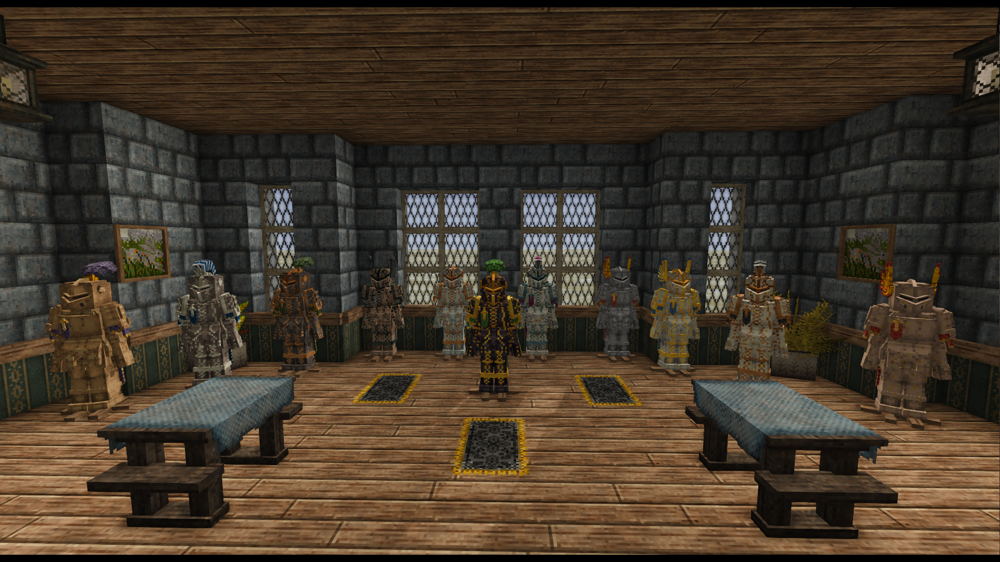
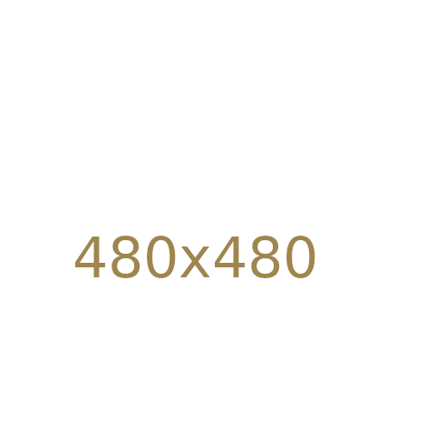
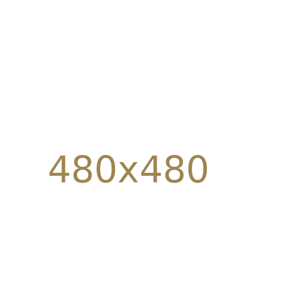
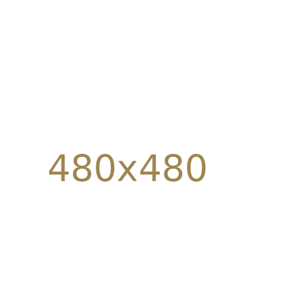
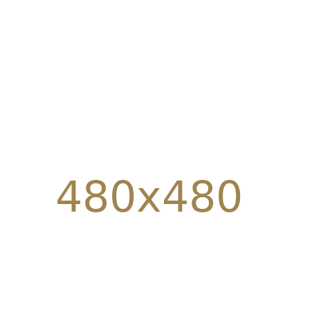
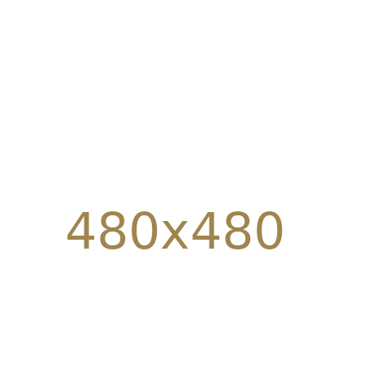
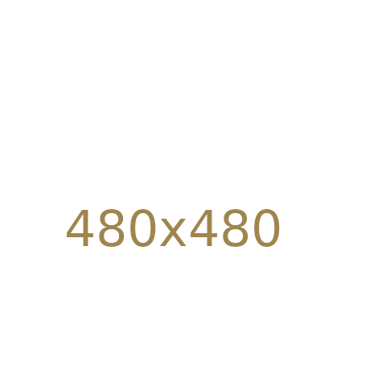

<link rel="stylesheet" href="{{ '/vintage-story/forgotten-armory/greenwich/greenwich.css' | relative_url }}">
<link rel="stylesheet" href="{{ '/vintage-story/forgotten-armory/greenwich/greenwich-decorations.css' | relative_url }}">

<link rel="stylesheet" href="{{ '/vintage-story/forgotten-armory/portfolio.css' | relative_url }}">

<a href="{{ '/vintage-story/forgotten-armory/' | relative_url }}">← Back to the armory</a>

<section class="hero greenwich-hero">
FORGOTTEN ARMORY
<h1>Jousting</h1>
Armor sets, decorations and material poses.
</section>
<nav class="greenwich-navigation" aria-label="Jousting sections">
<a href="#introduction">Introduction</a><a href="#frogmouth">Frogmouth Head</a><a href="#kolben">Kolben Head</a><a href="#stechzeug-body">Stechzeug Body</a><a href="#stechzeug-legs">Stechzeug Legs</a><a href="#poses">Poses</a></nav>
<section id="introduction" class="greenwich-section"><h2>Introduction</h2><section class="fa-introduction-set fa-introduction-set" id="stechzeug-set"><h3>Stechzeug set</h3></section></section>
<section id="frogmouth" class="greenwich-section"><h2>Frogmouth — Head ornaments</h2><section class="greenwich-decoration-group"><h3>Communis</h3>
<figure class="greenwich-card"><figcaption>Communis-Pennae</figcaption></figure><figure class="greenwich-card"><figcaption>Communis-Pluma</figcaption></figure><figure class="greenwich-card"><figcaption>Communis-Crista</figcaption></figure><figure class="greenwich-card"><figcaption>Communis-Pinna</figcaption></figure><figure class="greenwich-card"><figcaption>Communis-Sertum</figcaption></figure><figure class="greenwich-card"><figcaption>Communis-Transversa</figcaption></figure><figure class="greenwich-card"><figcaption>Communis-Vexillum</figcaption></figure><figure class="greenwich-card"><figcaption>Communis-Cauda</figcaption></figure><figure class="greenwich-card"><figcaption>Communis-Laurea</figcaption></figure><figure class="greenwich-card"><figcaption>Communis-Corona</figcaption></figure><figure class="greenwich-card"><figcaption>Communis-Cervinus</figcaption></figure><figure class="greenwich-card"><figcaption>Communis-Arietinus</figcaption></figure><figure class="greenwich-card"><figcaption>Communis-Taurinus</figcaption></figure><figure class="greenwich-card"><figcaption>Bear</figcaption></figure><figure class="greenwich-card"><figcaption>Wolf</figcaption></figure>
</section><section class="greenwich-decoration-group"><h3>Regalis</h3>
<figure class="greenwich-card"><figcaption>Regalis-Crista</figcaption></figure><figure class="greenwich-card"><figcaption>Regalis-Transversa</figcaption></figure><figure class="greenwich-card"><figcaption>Regalis-Pennae</figcaption></figure><figure class="greenwich-card"><figcaption>Regalis-Pinna</figcaption></figure><figure class="greenwich-card"><figcaption>Regalis-Pluma</figcaption></figure><figure class="greenwich-card"><figcaption>Regalis-Sertum</figcaption></figure><figure class="greenwich-card"><figcaption>Regalis-Vexillum</figcaption></figure><figure class="greenwich-card"><figcaption>Regalis-Cauda</figcaption></figure><figure class="greenwich-card"><figcaption>Regalis-Laurea</figcaption></figure><figure class="greenwich-card"><figcaption>Regalis-Corona</figcaption></figure><figure class="greenwich-card"><figcaption>Regalis-Cervinus</figcaption></figure><figure class="greenwich-card"><figcaption>Regalis-Arietinus</figcaption></figure><figure class="greenwich-card"><figcaption>Regalis-Taurinus</figcaption></figure>
</section><section class="greenwich-decoration-group"><h3>Metallicus</h3>
<figure class="greenwich-card"><figcaption>Metallicus-Laurea</figcaption></figure><figure class="greenwich-card"><figcaption>Metallicus-Corona</figcaption></figure><figure class="greenwich-card"><figcaption>Metallicus-Cervinus</figcaption></figure><figure class="greenwich-card"><figcaption>Metallicus-Arietinus</figcaption></figure><figure class="greenwich-card"><figcaption>Metallicus-Taurinus</figcaption></figure>
</section></section>
<section id="kolben" class="greenwich-section"><h2>Kolben — Head ornaments</h2><section class="greenwich-decoration-group"><h3>Communis</h3>
<figure class="greenwich-card"><figcaption>Communis-Pennae</figcaption></figure><figure class="greenwich-card"><figcaption>Communis-Pluma</figcaption></figure><figure class="greenwich-card"><figcaption>Communis-Crista</figcaption></figure><figure class="greenwich-card"><figcaption>Communis-Pinna</figcaption></figure><figure class="greenwich-card"><figcaption>Communis-Sertum</figcaption></figure><figure class="greenwich-card"><figcaption>Communis-Transversa</figcaption></figure><figure class="greenwich-card"><figcaption>Communis-Vexillum</figcaption></figure><figure class="greenwich-card"><figcaption>Communis-Cauda</figcaption></figure><figure class="greenwich-card"><figcaption>Communis-Laurea</figcaption></figure><figure class="greenwich-card"><figcaption>Communis-Corona</figcaption></figure><figure class="greenwich-card"><figcaption>Communis-Cervinus</figcaption></figure><figure class="greenwich-card"><figcaption>Communis-Arietinus</figcaption></figure><figure class="greenwich-card"><figcaption>Communis-Taurinus</figcaption></figure><figure class="greenwich-card"><figcaption>Bear</figcaption></figure><figure class="greenwich-card"><figcaption>Wolf</figcaption></figure>
</section><section class="greenwich-decoration-group"><h3>Regalis</h3>
<figure class="greenwich-card"><figcaption>Regalis-Crista</figcaption></figure><figure class="greenwich-card"><figcaption>Regalis-Transversa</figcaption></figure><figure class="greenwich-card"><figcaption>Regalis-Pennae</figcaption></figure><figure class="greenwich-card"><figcaption>Regalis-Pinna</figcaption></figure><figure class="greenwich-card"><figcaption>Regalis-Pluma</figcaption></figure><figure class="greenwich-card"><figcaption>Regalis-Sertum</figcaption></figure><figure class="greenwich-card"><figcaption>Regalis-Vexillum</figcaption></figure><figure class="greenwich-card"><figcaption>Regalis-Cauda</figcaption></figure><figure class="greenwich-card"><figcaption>Regalis-Laurea</figcaption></figure><figure class="greenwich-card"><figcaption>Regalis-Corona</figcaption></figure><figure class="greenwich-card"><figcaption>Regalis-Cervinus</figcaption></figure><figure class="greenwich-card"><figcaption>Regalis-Arietinus</figcaption></figure><figure class="greenwich-card"><figcaption>Regalis-Taurinus</figcaption></figure>
</section><section class="greenwich-decoration-group"><h3>Metallicus</h3>
<figure class="greenwich-card"><figcaption>Metallicus-Laurea</figcaption></figure><figure class="greenwich-card"><figcaption>Metallicus-Corona</figcaption></figure><figure class="greenwich-card"><figcaption>Metallicus-Cervinus</figcaption></figure><figure class="greenwich-card"><figcaption>Metallicus-Arietinus</figcaption></figure><figure class="greenwich-card"><figcaption>Metallicus-Taurinus</figcaption></figure>
</section></section>
<section id="stechzeug-body" class="greenwich-section"><h2>Stechzeug — Body brackets</h2><section class="greenwich-decoration-group"><h3>Brackets</h3>
<figure class="greenwich-card"><figcaption>Insignia</figcaption></figure><figure class="greenwich-card"><figcaption>Pectorale</figcaption></figure><figure class="greenwich-card"><figcaption>Cingulum</figcaption></figure><figure class="greenwich-card"><figcaption>Mantellum</figcaption></figure><figure class="greenwich-card"><figcaption>Vexillum</figcaption></figure><figure class="greenwich-card"><figcaption>Balterus</figcaption></figure><figure class="greenwich-card"><figcaption>Bear</figcaption></figure><figure class="greenwich-card"><figcaption>Wolf</figcaption></figure>
</section></section>
<section id="stechzeug-legs" class="greenwich-section"><h2>Stechzeug — Legs fasteners</h2><section class="greenwich-decoration-group"><h3>Fasteners</h3>
<figure class="greenwich-card"><figcaption>Lacinia</figcaption></figure><figure class="greenwich-card"><figcaption>Genuale</figcaption></figure><figure class="greenwich-card"><figcaption>Falda</figcaption></figure><figure class="greenwich-card"><figcaption>Bear</figcaption></figure><figure class="greenwich-card"><figcaption>Wolf</figcaption></figure>
</section></section>
<section id="poses" class="greenwich-section fa-poses" aria-labelledby="poses-title"><h2 id="poses-title">Poses</h2><section class="fa-pose-set" id="stechzeug-poses"><h3 id="stechzeug-poses-title">Stechzeug set</h3>
<figure class="greenwich-card"><figcaption>Stechzeug — Iron — Pose 1</figcaption></figure><figure class="greenwich-card"><figcaption>Stechzeug — Iron — Pose 2</figcaption></figure><figure class="greenwich-card"><figcaption>Stechzeug — Meteoric Iron — Pose 1</figcaption></figure><figure class="greenwich-card"><figcaption>Stechzeug — Meteoric Iron — Pose 2</figcaption></figure><figure class="greenwich-card"><figcaption>Stechzeug — Steel — Pose 1</figcaption></figure><figure class="greenwich-card"><figcaption>Stechzeug — Steel — Pose 2</figcaption></figure>
</section></section>

