<link rel="stylesheet" href="{{ '/vintage-story/forgotten-armory/greenwich/greenwich.css' | relative_url }}">
<link rel="stylesheet" href="{{ '/vintage-story/forgotten-armory/greenwich/greenwich-decorations.css' | relative_url }}">

<link rel="stylesheet" href="{{ '/vintage-story/forgotten-armory/portfolio.css' | relative_url }}">

<a href="{{ '/vintage-story/forgotten-armory/' | relative_url }}">← Back to the armory</a>

<section class="hero greenwich-hero">
FORGOTTEN ARMORY
<h1>Templar</h1>
Armor sets, decorations and material poses.
</section>
<nav class="greenwich-navigation" aria-label="Templar sections">
<a href="#introduction">Introduction</a><a href="#boxhelm">Boxhelm Head</a><a href="#sugarloafhelm">Sugarloafhelm Head</a><a href="#guard-helmet">Pothelm Head</a><a href="#pothelmmasked">Pothelm Masked Head</a><a href="#pawn-helmet">Spangenhelm Head</a><a href="#noble-body">Noble Body</a><a href="#guard-body">Guard Body</a><a href="#pawn-body">Pawn Body</a><a href="#noble-legs">Noble Legs</a><a href="#guard-legs">Guard Legs</a><a href="#pawn-legs">Pawn Legs</a><a href="#poses">Poses</a></nav>
<section id="introduction" class="greenwich-section"><h2>Introduction</h2><section class="fa-introduction-set fa-introduction-set" id="noble-set"><h3>Noble set</h3></section><section class="fa-introduction-set fa-introduction-set" id="guard-set"><h3>Guard set</h3></section><section class="fa-introduction-set fa-introduction-set" id="pawn-set"><h3>Pawn set</h3><a class="greenwich-image greenwich-wideshot" href="images/introduction/pawnset.png" aria-label="Open Pawn set">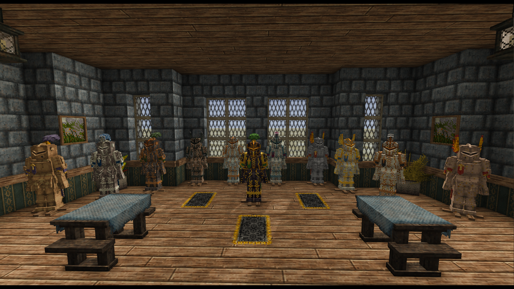</a></section></section>
<section id="boxhelm" class="greenwich-section"><h2>Boxhelm — Head ornaments</h2><section class="greenwich-decoration-group"><h3>Communis</h3>
<figure class="greenwich-card"><a class="greenwich-image" href="images/boxhelm/communis/pennae.png" aria-label="Open Communis-Pennae">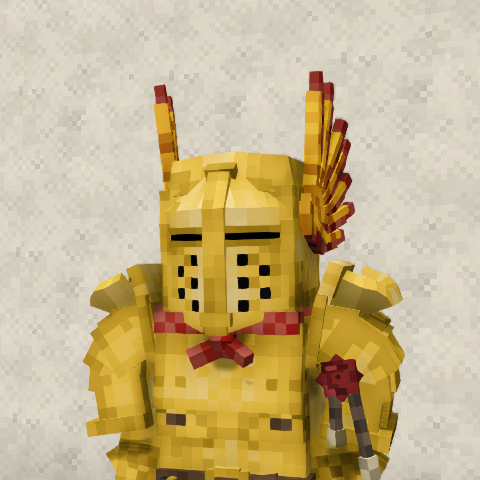</a><figcaption>Communis-Pennae</figcaption></figure><figure class="greenwich-card"><a class="greenwich-image" href="images/boxhelm/communis/pluma.png" aria-label="Open Communis-Pluma">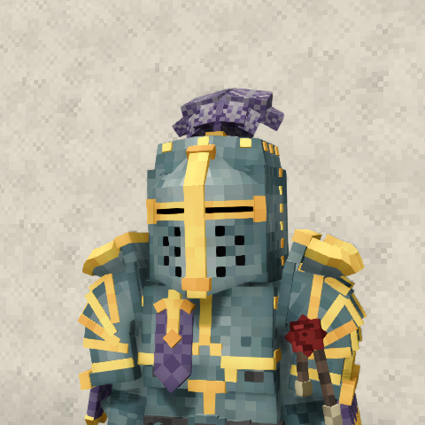</a><figcaption>Communis-Pluma</figcaption></figure><figure class="greenwich-card"><a class="greenwich-image" href="images/boxhelm/communis/crista.png" aria-label="Open Communis-Crista">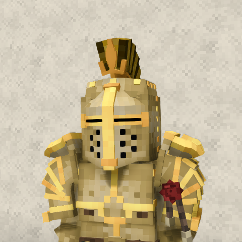</a><figcaption>Communis-Crista</figcaption></figure><figure class="greenwich-card"><a class="greenwich-image" href="images/boxhelm/communis/pinna.png" aria-label="Open Communis-Pinna">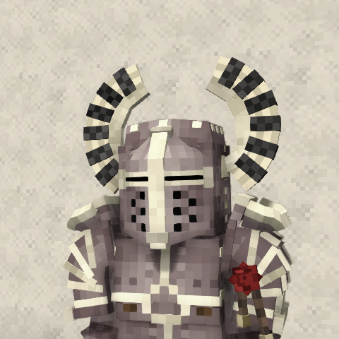</a><figcaption>Communis-Pinna</figcaption></figure><figure class="greenwich-card"><a class="greenwich-image" href="images/boxhelm/communis/sertum.png" aria-label="Open Communis-Sertum">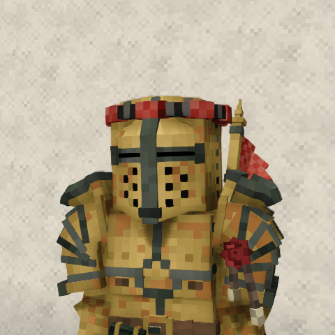</a><figcaption>Communis-Sertum</figcaption></figure><figure class="greenwich-card"><a class="greenwich-image" href="images/boxhelm/communis/transversa.png" aria-label="Open Communis-Transversa">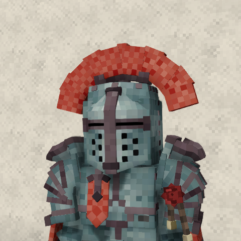</a><figcaption>Communis-Transversa</figcaption></figure><figure class="greenwich-card"><a class="greenwich-image" href="images/boxhelm/communis/statua.png" aria-label="Open Communis-Statua">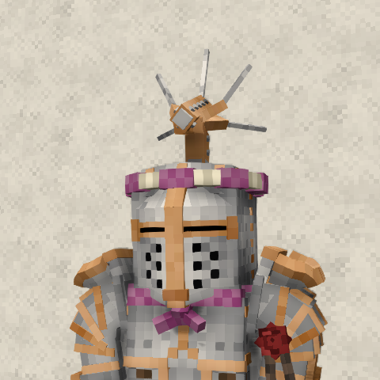</a><figcaption>Communis-Statua</figcaption></figure><figure class="greenwich-card"><a class="greenwich-image" href="images/boxhelm/communis/cauda.png" aria-label="Open Communis-Cauda">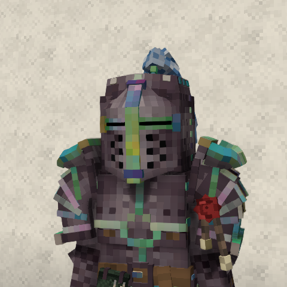</a><figcaption>Communis-Cauda</figcaption></figure><figure class="greenwich-card"><figcaption>Communis-Laurea</figcaption></figure><figure class="greenwich-card"><figcaption>Communis-Corona</figcaption></figure><figure class="greenwich-card"><figcaption>Communis-Cervinus</figcaption></figure><figure class="greenwich-card"><figcaption>Communis-Arietinus</figcaption></figure><figure class="greenwich-card"><figcaption>Communis-Taurinus</figcaption></figure><figure class="greenwich-card"><a class="greenwich-image" href="images/boxhelm/bear.png" aria-label="Open Bear">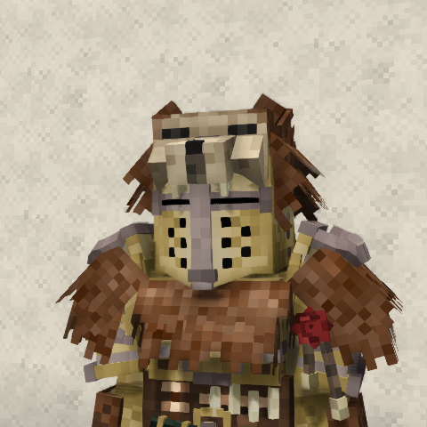</a><figcaption>Bear</figcaption></figure><figure class="greenwich-card"><a class="greenwich-image" href="images/boxhelm/wolf.png" aria-label="Open Wolf">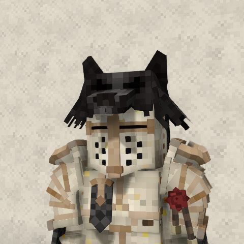</a><figcaption>Wolf</figcaption></figure>
</section><section class="greenwich-decoration-group"><h3>Regalis</h3>
<figure class="greenwich-card"><a class="greenwich-image" href="images/boxhelm/regalis/crista.png" aria-label="Open Regalis-Crista">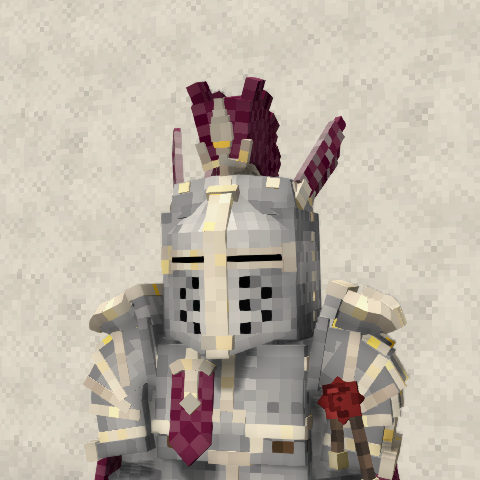</a><figcaption>Regalis-Crista</figcaption></figure><figure class="greenwich-card"><figcaption>Regalis-Transversa</figcaption></figure><figure class="greenwich-card"><figcaption>Regalis-Pennae</figcaption></figure><figure class="greenwich-card"><figcaption>Regalis-Pinna</figcaption></figure><figure class="greenwich-card"><a class="greenwich-image" href="images/boxhelm/regalis/pluma.png" aria-label="Open Regalis-Pluma">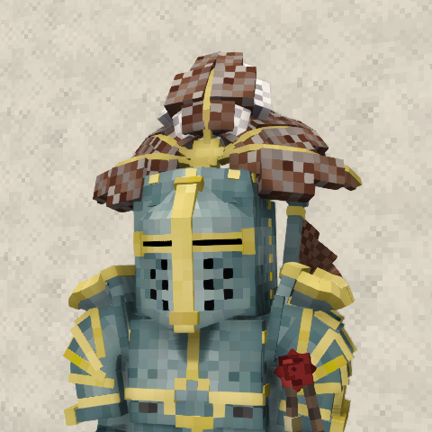</a><figcaption>Regalis-Pluma</figcaption></figure><figure class="greenwich-card"><a class="greenwich-image" href="images/boxhelm/regalis/sertum.png" aria-label="Open Regalis-Sertum">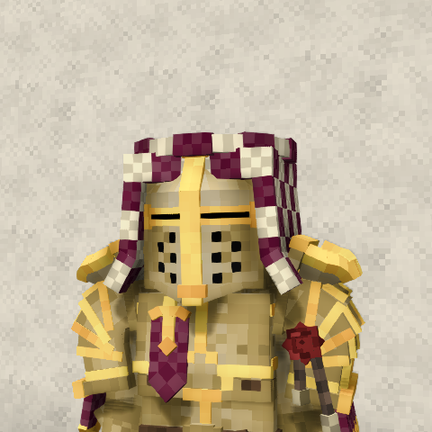</a><figcaption>Regalis-Sertum</figcaption></figure><figure class="greenwich-card"><a class="greenwich-image" href="images/boxhelm/regalis/statua.png" aria-label="Open Regalis-Statua">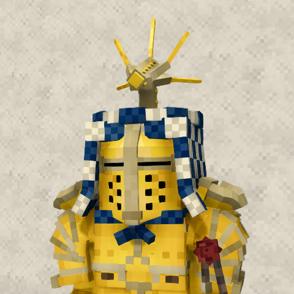</a><figcaption>Regalis-Statua</figcaption></figure><figure class="greenwich-card"><figcaption>Regalis-Cauda</figcaption></figure><figure class="greenwich-card"><figcaption>Regalis-Laurea</figcaption></figure><figure class="greenwich-card"><figcaption>Regalis-Corona</figcaption></figure><figure class="greenwich-card"><figcaption>Regalis-Cervinus</figcaption></figure><figure class="greenwich-card"><figcaption>Regalis-Arietinus</figcaption></figure><figure class="greenwich-card"><figcaption>Regalis-Taurinus</figcaption></figure><figure class="greenwich-card"><figcaption>Regalis-Vexillum</figcaption></figure>
</section><section class="greenwich-decoration-group"><h3>Metallicus</h3>
<figure class="greenwich-card"><a class="greenwich-image" href="images/boxhelm/metallicus/laurea.png" aria-label="Open Metallicus-Laurea">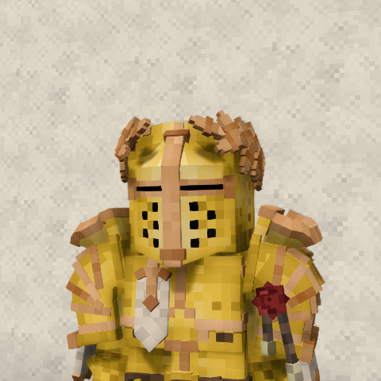</a><figcaption>Metallicus-Laurea</figcaption></figure><figure class="greenwich-card"><a class="greenwich-image" href="images/boxhelm/metallicus/corona.png" aria-label="Open Metallicus-Corona">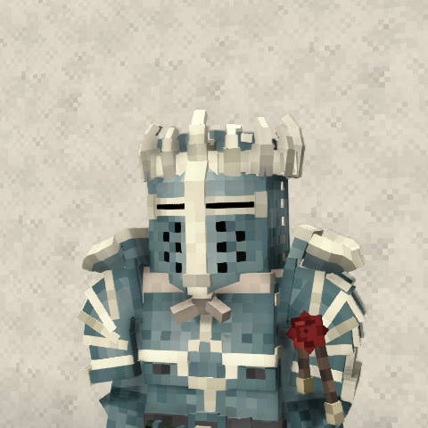</a><figcaption>Metallicus-Corona</figcaption></figure><figure class="greenwich-card"><figcaption>Metallicus-Cervinus</figcaption></figure><figure class="greenwich-card"><a class="greenwich-image" href="images/boxhelm/metallicus/arietinus.png" aria-label="Open Metallicus-Arietinus">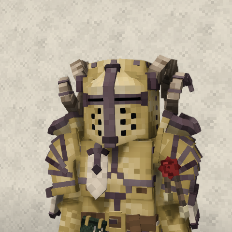</a><figcaption>Metallicus-Arietinus</figcaption></figure><figure class="greenwich-card"><figcaption>Metallicus-Taurinus</figcaption></figure>
<figure class="greenwich-card"><a class="greenwich-image" href="images/boxhelm/metallicus/statua.png" aria-label="Open Metallicus-Statua">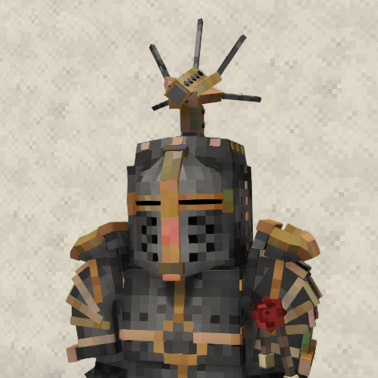</a><figcaption>Metallicus-Statua</figcaption></figure>

</section></section>

<section id="sugarloafhelm" class="greenwich-section"><h2>Sugarloafhelm — Head ornaments</h2><section class="greenwich-decoration-group"><h3>Communis</h3>
<figure class="greenwich-card"><a class="greenwich-image" href="images/sugarloafhelm/communis/pennae.png" aria-label="Open Communis-Pennae">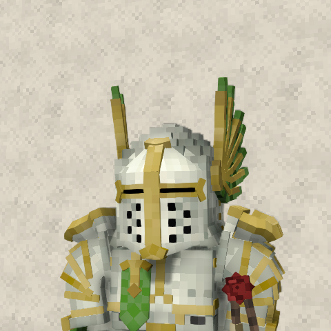</a><figcaption>Communis-Pennae</figcaption></figure><figure class="greenwich-card"><a class="greenwich-image" href="images/sugarloafhelm/communis/pluma.png" aria-label="Open Communis-Pluma">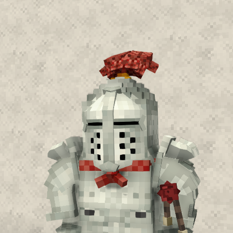</a><figcaption>Communis-Pluma</figcaption></figure><figure class="greenwich-card"><a class="greenwich-image" href="images/sugarloafhelm/communis/crista.png" aria-label="Open Communis-Crista">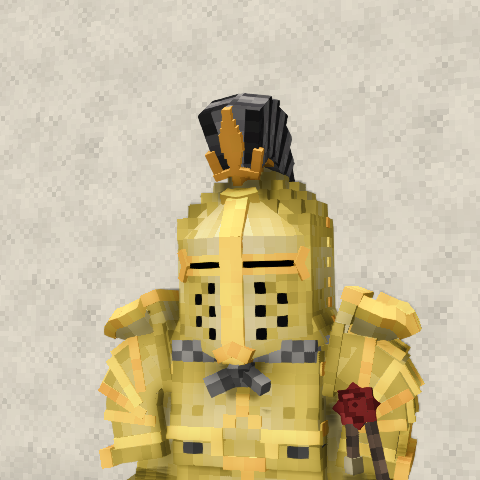</a><figcaption>Communis-Crista</figcaption></figure><figure class="greenwich-card"><a class="greenwich-image" href="images/sugarloafhelm/communis/pinna.png" aria-label="Open Communis-Pinna">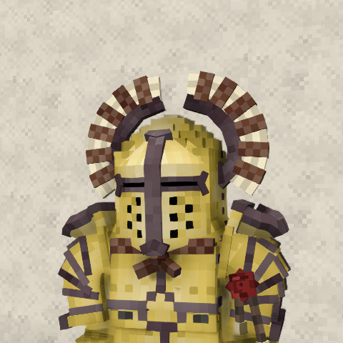</a><figcaption>Communis-Pinna</figcaption></figure><figure class="greenwich-card"><a class="greenwich-image" href="images/sugarloafhelm/communis/sertum.png" aria-label="Open Communis-Sertum">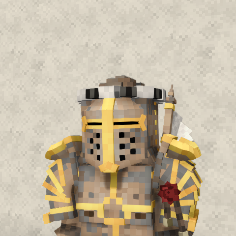</a><figcaption>Communis-Sertum</figcaption></figure><figure class="greenwich-card"><a class="greenwich-image" href="images/sugarloafhelm/communis/transversa.png" aria-label="Open Communis-Transversa">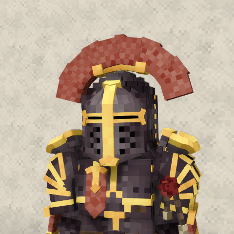</a><figcaption>Communis-Transversa</figcaption></figure><figure class="greenwich-card"><a class="greenwich-image" href="images/sugarloafhelm/communis/statua.png" aria-label="Open Communis-Statua">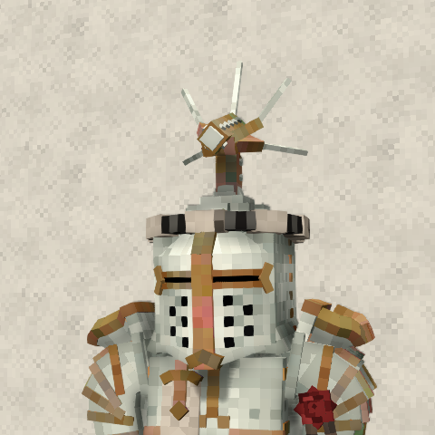</a><figcaption>Communis-Statua</figcaption></figure><figure class="greenwich-card"><a class="greenwich-image" href="images/sugarloafhelm/communis/cauda.png" aria-label="Open Communis-Cauda">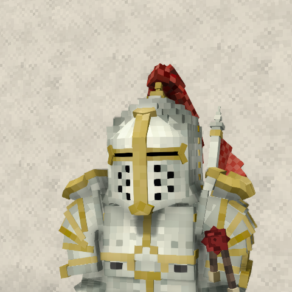</a><figcaption>Communis-Cauda</figcaption></figure><figure class="greenwich-card"><figcaption>Communis-Laurea</figcaption></figure><figure class="greenwich-card"><figcaption>Communis-Corona</figcaption></figure><figure class="greenwich-card"><figcaption>Communis-Cervinus</figcaption></figure><figure class="greenwich-card"><figcaption>Communis-Arietinus</figcaption></figure><figure class="greenwich-card"><figcaption>Communis-Taurinus</figcaption></figure><figure class="greenwich-card"><a class="greenwich-image" href="images/sugarloafhelm/bear.png" aria-label="Open Bear">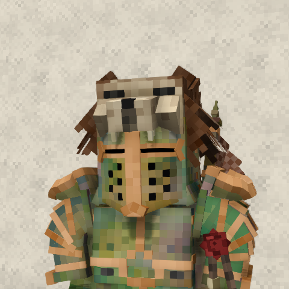</a><figcaption>Bear</figcaption></figure><figure class="greenwich-card"><a class="greenwich-image" href="images/sugarloafhelm/wolf.png" aria-label="Open Wolf">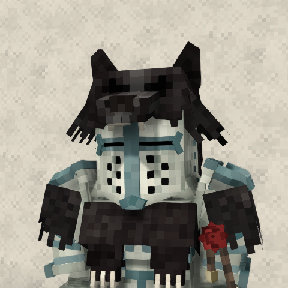</a><figcaption>Wolf</figcaption></figure>
</section><section class="greenwich-decoration-group"><h3>Regalis</h3>
<figure class="greenwich-card"><a class="greenwich-image" href="images/sugarloafhelm/regalis/crista.png" aria-label="Open Regalis-Crista">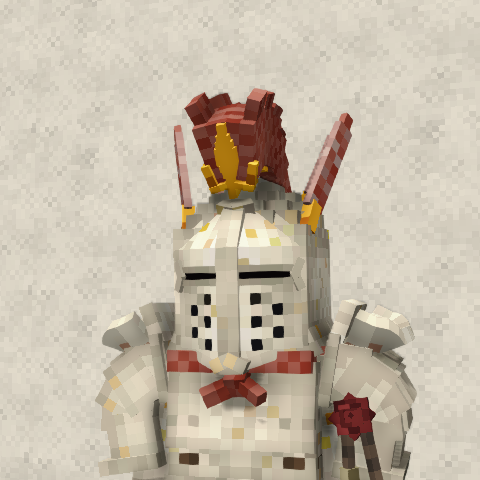</a><figcaption>Regalis-Crista</figcaption></figure><figure class="greenwich-card"><figcaption>Regalis-Transversa</figcaption></figure><figure class="greenwich-card"><figcaption>Regalis-Pennae</figcaption></figure><figure class="greenwich-card"><figcaption>Regalis-Pinna</figcaption></figure><figure class="greenwich-card"><a class="greenwich-image" href="images/sugarloafhelm/regalis/pluma.png" aria-label="Open Regalis-Pluma">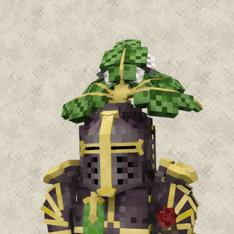</a><figcaption>Regalis-Pluma</figcaption></figure><figure class="greenwich-card"><a class="greenwich-image" href="images/sugarloafhelm/regalis/sertum.png" aria-label="Open Regalis-Sertum">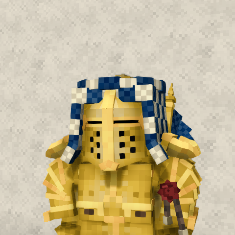</a><figcaption>Regalis-Sertum</figcaption></figure><figure class="greenwich-card"><a class="greenwich-image" href="images/sugarloafhelm/regalis/statua.png" aria-label="Open Regalis-Statua">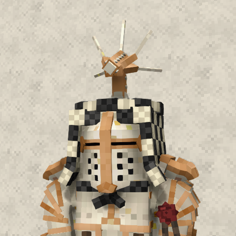</a><figcaption>Regalis-Statua</figcaption></figure><figure class="greenwich-card"><figcaption>Regalis-Cauda</figcaption></figure><figure class="greenwich-card"><figcaption>Regalis-Laurea</figcaption></figure><figure class="greenwich-card"><figcaption>Regalis-Corona</figcaption></figure><figure class="greenwich-card"><figcaption>Regalis-Cervinus</figcaption></figure><figure class="greenwich-card"><figcaption>Regalis-Arietinus</figcaption></figure><figure class="greenwich-card"><figcaption>Regalis-Taurinus</figcaption></figure><figure class="greenwich-card"><figcaption>Regalis-Vexillum</figcaption></figure>
</section><section class="greenwich-decoration-group"><h3>Metallicus</h3>
<figure class="greenwich-card"><a class="greenwich-image" href="images/sugarloafhelm/metallicus/laurea.png" aria-label="Open Metallicus-Laurea">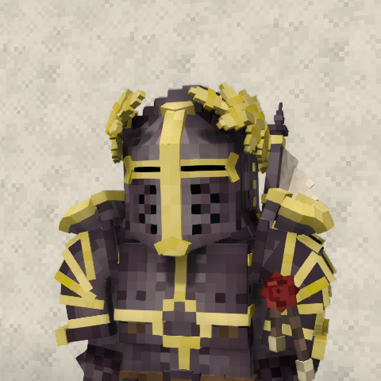</a><figcaption>Metallicus-Laurea</figcaption></figure><figure class="greenwich-card"><a class="greenwich-image" href="images/sugarloafhelm/metallicus/corona.png" aria-label="Open Metallicus-Corona">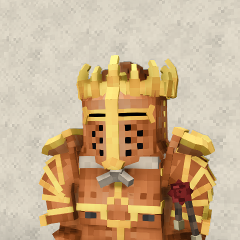</a><figcaption>Metallicus-Corona</figcaption></figure><figure class="greenwich-card"><figcaption>Metallicus-Cervinus</figcaption></figure><figure class="greenwich-card"><a class="greenwich-image" href="images/sugarloafhelm/metallicus/arietinus.png" aria-label="Open Metallicus-Arietinus">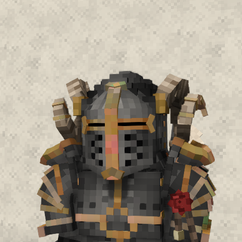</a><figcaption>Metallicus-Arietinus</figcaption></figure><figure class="greenwich-card"><figcaption>Metallicus-Taurinus</figcaption></figure>
<figure class="greenwich-card"><a class="greenwich-image" href="images/sugarloafhelm/metallicus/statua.png" aria-label="Open Metallicus-Statua">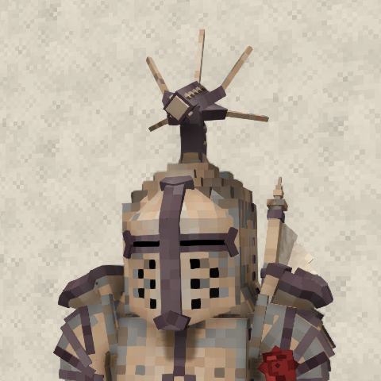</a><figcaption>Metallicus-Statua</figcaption></figure>

</section></section>

<section id="guard-helmet" class="greenwich-section"><h2>Pothelm — Head ornaments</h2><section class="greenwich-decoration-group"><h3>Communis</h3>
<figure class="greenwich-card"><a class="greenwich-image" href="images/pothelm/communis/pennae.png" aria-label="Open Communis-Pennae">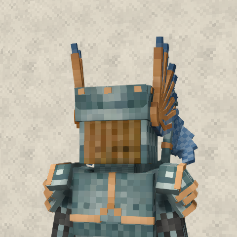</a><figcaption>Communis-Pennae</figcaption></figure><figure class="greenwich-card"><a class="greenwich-image" href="images/pothelm/communis/pluma.png" aria-label="Open Communis-Pluma">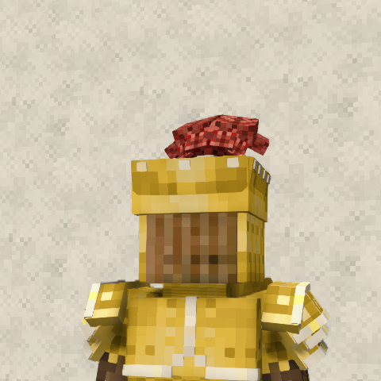</a><figcaption>Communis-Pluma</figcaption></figure><figure class="greenwich-card"><a class="greenwich-image" href="images/pothelm/communis/crista.png" aria-label="Open Communis-Crista">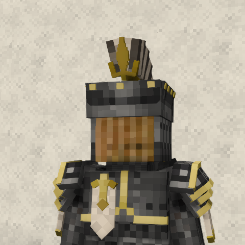</a><figcaption>Communis-Crista</figcaption></figure><figure class="greenwich-card"><a class="greenwich-image" href="images/pothelm/communis/pinna.png" aria-label="Open Communis-Pinna">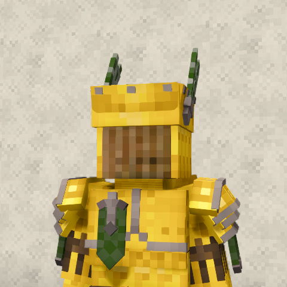</a><figcaption>Communis-Pinna</figcaption></figure><figure class="greenwich-card"><a class="greenwich-image" href="images/pothelm/communis/sertum.png" aria-label="Open Communis-Sertum">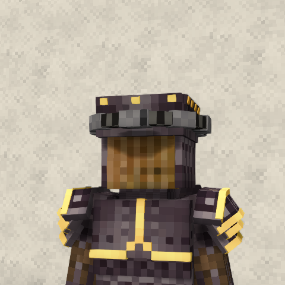</a><figcaption>Communis-Sertum</figcaption></figure><figure class="greenwich-card"><a class="greenwich-image" href="images/pothelm/communis/transversa.png" aria-label="Open Communis-Transversa">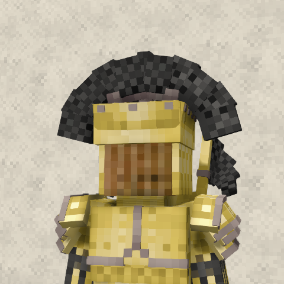</a><figcaption>Communis-Transversa</figcaption></figure><figure class="greenwich-card"><a class="greenwich-image" href="images/pothelm/communis/statua.png" aria-label="Open Communis-Statua">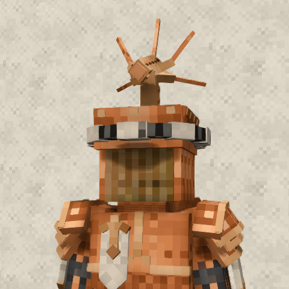</a><figcaption>Communis-Statua</figcaption></figure><figure class="greenwich-card"><a class="greenwich-image" href="images/pothelm/communis/cauda.png" aria-label="Open Communis-Cauda">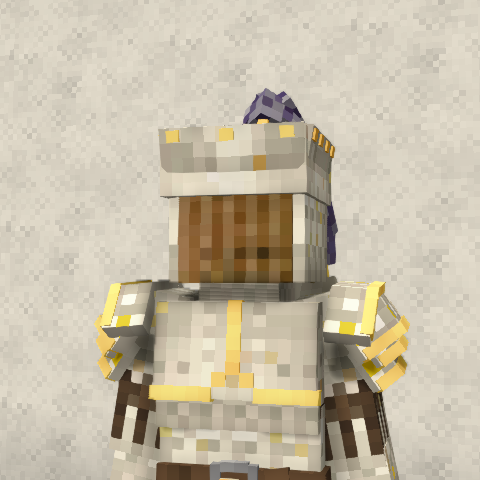</a><figcaption>Communis-Cauda</figcaption></figure><figure class="greenwich-card"><figcaption>Communis-Laurea</figcaption></figure><figure class="greenwich-card"><figcaption>Communis-Corona</figcaption></figure><figure class="greenwich-card"><figcaption>Communis-Cervinus</figcaption></figure><figure class="greenwich-card"><figcaption>Communis-Arietinus</figcaption></figure><figure class="greenwich-card"><figcaption>Communis-Taurinus</figcaption></figure><figure class="greenwich-card"><a class="greenwich-image" href="images/pothelm/bear.png" aria-label="Open Bear">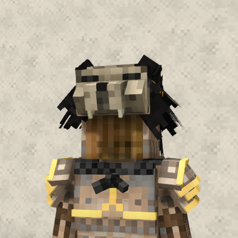</a><figcaption>Bear</figcaption></figure><figure class="greenwich-card"><a class="greenwich-image" href="images/pothelm/wolf.png" aria-label="Open Wolf">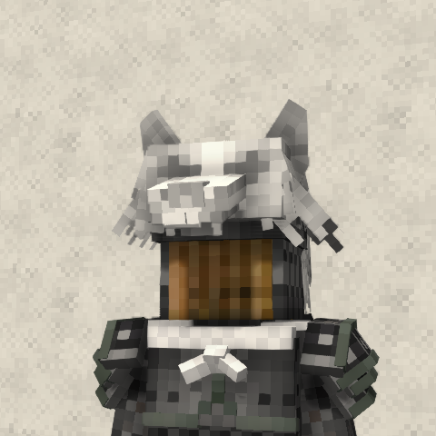</a><figcaption>Wolf</figcaption></figure>
</section><section class="greenwich-decoration-group"><h3>Regalis</h3>
<figure class="greenwich-card"><a class="greenwich-image" href="images/pothelm/regalis/crista.png" aria-label="Open Regalis-Crista">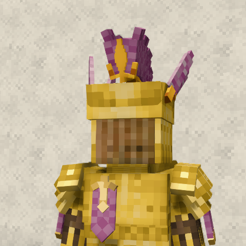</a><figcaption>Regalis-Crista</figcaption></figure><figure class="greenwich-card"><figcaption>Regalis-Transversa</figcaption></figure><figure class="greenwich-card"><figcaption>Regalis-Pennae</figcaption></figure><figure class="greenwich-card"><figcaption>Regalis-Pinna</figcaption></figure><figure class="greenwich-card"><a class="greenwich-image" href="images/pothelm/regalis/pluma.png" aria-label="Open Regalis-Pluma">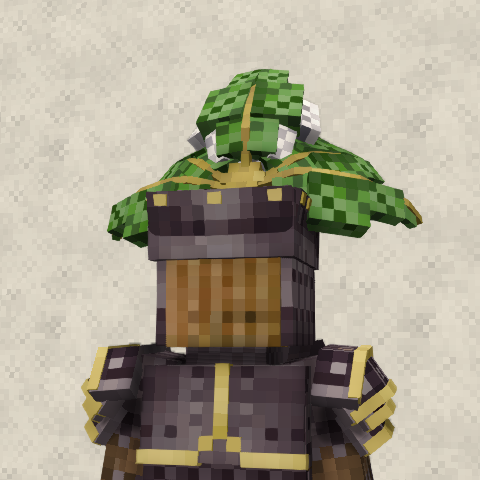</a><figcaption>Regalis-Pluma</figcaption></figure><figure class="greenwich-card"><a class="greenwich-image" href="images/pothelm/regalis/sertum.png" aria-label="Open Regalis-Sertum">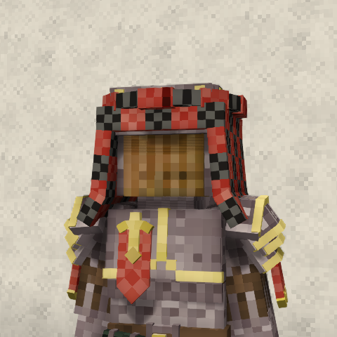</a><figcaption>Regalis-Sertum</figcaption></figure><figure class="greenwich-card"><figcaption>Regalis-Statua</figcaption></figure><figure class="greenwich-card"><figcaption>Regalis-Cauda</figcaption></figure><figure class="greenwich-card"><figcaption>Regalis-Laurea</figcaption></figure><figure class="greenwich-card"><figcaption>Regalis-Corona</figcaption></figure><figure class="greenwich-card"><figcaption>Regalis-Cervinus</figcaption></figure><figure class="greenwich-card"><figcaption>Regalis-Arietinus</figcaption></figure><figure class="greenwich-card"><figcaption>Regalis-Taurinus</figcaption></figure><figure class="greenwich-card"><figcaption>Regalis-Vexillum</figcaption></figure>
</section><section class="greenwich-decoration-group"><h3>Metallicus</h3>
<figure class="greenwich-card"><figcaption>Metallicus-Laurea</figcaption></figure><figure class="greenwich-card"><figcaption>Metallicus-Corona</figcaption></figure><figure class="greenwich-card"><figcaption>Metallicus-Cervinus</figcaption></figure><figure class="greenwich-card"><figcaption>Metallicus-Arietinus</figcaption></figure><figure class="greenwich-card"><figcaption>Metallicus-Taurinus</figcaption></figure>
<figure class="greenwich-card"><figcaption>Metallicus-Statua</figcaption></figure>

</section></section>

<section id="pothelmmasked" class="greenwich-section"><h2>Pothelm Masked — Head ornaments</h2><section class="greenwich-decoration-group"><h3>Communis</h3>
<figure class="greenwich-card"><figcaption>Communis-Pennae</figcaption></figure><figure class="greenwich-card"><figcaption>Communis-Pluma</figcaption></figure><figure class="greenwich-card"><figcaption>Communis-Crista</figcaption></figure><figure class="greenwich-card"><figcaption>Communis-Pinna</figcaption></figure><figure class="greenwich-card"><figcaption>Communis-Sertum</figcaption></figure><figure class="greenwich-card"><figcaption>Communis-Transversa</figcaption></figure><figure class="greenwich-card"><figcaption>Communis-Statua</figcaption></figure><figure class="greenwich-card"><figcaption>Communis-Cauda</figcaption></figure><figure class="greenwich-card"><figcaption>Communis-Laurea</figcaption></figure><figure class="greenwich-card"><figcaption>Communis-Corona</figcaption></figure><figure class="greenwich-card"><figcaption>Communis-Cervinus</figcaption></figure><figure class="greenwich-card"><figcaption>Communis-Arietinus</figcaption></figure><figure class="greenwich-card"><figcaption>Communis-Taurinus</figcaption></figure><figure class="greenwich-card"><figcaption>Bear</figcaption></figure><figure class="greenwich-card"><figcaption>Wolf</figcaption></figure>
</section><section class="greenwich-decoration-group"><h3>Regalis</h3>
<figure class="greenwich-card"><figcaption>Regalis-Crista</figcaption></figure><figure class="greenwich-card"><figcaption>Regalis-Transversa</figcaption></figure><figure class="greenwich-card"><figcaption>Regalis-Pennae</figcaption></figure><figure class="greenwich-card"><figcaption>Regalis-Pinna</figcaption></figure><figure class="greenwich-card"><figcaption>Regalis-Pluma</figcaption></figure><figure class="greenwich-card"><figcaption>Regalis-Sertum</figcaption></figure><figure class="greenwich-card"><figcaption>Regalis-Statua</figcaption></figure><figure class="greenwich-card"><figcaption>Regalis-Cauda</figcaption></figure><figure class="greenwich-card"><figcaption>Regalis-Laurea</figcaption></figure><figure class="greenwich-card"><figcaption>Regalis-Corona</figcaption></figure><figure class="greenwich-card"><figcaption>Regalis-Cervinus</figcaption></figure><figure class="greenwich-card"><figcaption>Regalis-Arietinus</figcaption></figure><figure class="greenwich-card"><figcaption>Regalis-Taurinus</figcaption></figure><figure class="greenwich-card"><figcaption>Regalis-Vexillum</figcaption></figure>
</section><section class="greenwich-decoration-group"><h3>Metallicus</h3>
<figure class="greenwich-card"><figcaption>Metallicus-Laurea</figcaption></figure><figure class="greenwich-card"><figcaption>Metallicus-Corona</figcaption></figure><figure class="greenwich-card"><figcaption>Metallicus-Cervinus</figcaption></figure><figure class="greenwich-card"><figcaption>Metallicus-Arietinus</figcaption></figure><figure class="greenwich-card"><figcaption>Metallicus-Taurinus</figcaption></figure>
<figure class="greenwich-card"><figcaption>Metallicus-Statua</figcaption></figure>

</section></section>

<section id="pawn-helmet" class="greenwich-section"><h2>Spangenhelm — Head ornaments</h2><section class="greenwich-decoration-group"><h3>Communis</h3>
<figure class="greenwich-card"><figcaption>Communis-Pennae</figcaption></figure><figure class="greenwich-card"><figcaption>Communis-Pluma</figcaption></figure><figure class="greenwich-card"><figcaption>Communis-Crista</figcaption></figure><figure class="greenwich-card"><figcaption>Communis-Pinna</figcaption></figure><figure class="greenwich-card"><figcaption>Communis-Sertum</figcaption></figure><figure class="greenwich-card"><figcaption>Communis-Transversa</figcaption></figure><figure class="greenwich-card"><figcaption>Communis-Statua</figcaption></figure><figure class="greenwich-card"><figcaption>Communis-Cauda</figcaption></figure><figure class="greenwich-card"><figcaption>Communis-Laurea</figcaption></figure><figure class="greenwich-card"><figcaption>Communis-Corona</figcaption></figure><figure class="greenwich-card"><figcaption>Communis-Cervinus</figcaption></figure><figure class="greenwich-card"><figcaption>Communis-Arietinus</figcaption></figure><figure class="greenwich-card"><figcaption>Communis-Taurinus</figcaption></figure><figure class="greenwich-card"><figcaption>Bear</figcaption></figure><figure class="greenwich-card"><figcaption>Wolf</figcaption></figure>
</section><section class="greenwich-decoration-group"><h3>Regalis</h3>
<figure class="greenwich-card"><figcaption>Regalis-Crista</figcaption></figure><figure class="greenwich-card"><figcaption>Regalis-Transversa</figcaption></figure><figure class="greenwich-card"><figcaption>Regalis-Pennae</figcaption></figure><figure class="greenwich-card"><figcaption>Regalis-Pinna</figcaption></figure><figure class="greenwich-card"><figcaption>Regalis-Pluma</figcaption></figure><figure class="greenwich-card"><figcaption>Regalis-Sertum</figcaption></figure><figure class="greenwich-card"><figcaption>Regalis-Statua</figcaption></figure><figure class="greenwich-card"><figcaption>Regalis-Cauda</figcaption></figure><figure class="greenwich-card"><figcaption>Regalis-Laurea</figcaption></figure><figure class="greenwich-card"><figcaption>Regalis-Corona</figcaption></figure><figure class="greenwich-card"><figcaption>Regalis-Cervinus</figcaption></figure><figure class="greenwich-card"><figcaption>Regalis-Arietinus</figcaption></figure><figure class="greenwich-card"><figcaption>Regalis-Taurinus</figcaption></figure><figure class="greenwich-card"><figcaption>Regalis-Vexillum</figcaption></figure>
</section><section class="greenwich-decoration-group"><h3>Metallicus</h3>
<figure class="greenwich-card"><figcaption>Metallicus-Laurea</figcaption></figure><figure class="greenwich-card"><figcaption>Metallicus-Corona</figcaption></figure><figure class="greenwich-card"><figcaption>Metallicus-Cervinus</figcaption></figure><figure class="greenwich-card"><figcaption>Metallicus-Arietinus</figcaption></figure><figure class="greenwich-card"><figcaption>Metallicus-Taurinus</figcaption></figure>
<figure class="greenwich-card"><figcaption>Metallicus-Statua</figcaption></figure>

</section></section>

<section id="noble-body" class="greenwich-section"><h2>Noble — Body brackets</h2><section class="greenwich-decoration-group"><h3>Brackets</h3>
<figure class="greenwich-card"><figcaption>Insignia</figcaption></figure><figure class="greenwich-card"><figcaption>Pectorale</figcaption></figure><figure class="greenwich-card"><figcaption>Cingulum</figcaption></figure><figure class="greenwich-card"><figcaption>Mantellum</figcaption></figure><figure class="greenwich-card"><figcaption>Vexillum</figcaption></figure><figure class="greenwich-card"><figcaption>Balterus</figcaption></figure><figure class="greenwich-card"><figcaption>Bear</figcaption></figure><figure class="greenwich-card"><figcaption>Wolf</figcaption></figure>
</section></section>

<section id="guard-body" class="greenwich-section"><h2>Guard — Body brackets</h2><section class="greenwich-decoration-group"><h3>Brackets</h3>
<figure class="greenwich-card"><figcaption>Insignia</figcaption></figure><figure class="greenwich-card"><figcaption>Pectorale</figcaption></figure><figure class="greenwich-card"><figcaption>Cingulum</figcaption></figure><figure class="greenwich-card"><figcaption>Mantellum</figcaption></figure><figure class="greenwich-card"><figcaption>Vexillum</figcaption></figure><figure class="greenwich-card"><figcaption>Balterus</figcaption></figure><figure class="greenwich-card"><figcaption>Bear</figcaption></figure><figure class="greenwich-card"><figcaption>Wolf</figcaption></figure>
</section></section>

<section id="pawn-body" class="greenwich-section"><h2>Pawn — Body brackets</h2><section class="greenwich-decoration-group"><h3>Brackets</h3>
<figure class="greenwich-card"><figcaption>Insignia</figcaption></figure><figure class="greenwich-card"><figcaption>Pectorale</figcaption></figure><figure class="greenwich-card"><figcaption>Cingulum</figcaption></figure><figure class="greenwich-card"><figcaption>Mantellum</figcaption></figure><figure class="greenwich-card"><figcaption>Vexillum</figcaption></figure><figure class="greenwich-card"><figcaption>Balterus</figcaption></figure><figure class="greenwich-card"><figcaption>Bear</figcaption></figure><figure class="greenwich-card"><figcaption>Wolf</figcaption></figure>
</section></section>

<section id="noble-legs" class="greenwich-section"><h2>Noble — Legs fasteners</h2><section class="greenwich-decoration-group"><h3>Fasteners</h3>
<figure class="greenwich-card"><figcaption>Lacinia</figcaption></figure><figure class="greenwich-card"><figcaption>Genuale</figcaption></figure><figure class="greenwich-card"><figcaption>Falda</figcaption></figure><figure class="greenwich-card"><figcaption>Bear</figcaption></figure><figure class="greenwich-card"><figcaption>Wolf</figcaption></figure>
</section></section>

<section id="guard-legs" class="greenwich-section"><h2>Guard — Legs fasteners</h2><section class="greenwich-decoration-group"><h3>Fasteners</h3>
<figure class="greenwich-card"><figcaption>Lacinia</figcaption></figure><figure class="greenwich-card"><figcaption>Genuale</figcaption></figure><figure class="greenwich-card"><figcaption>Falda</figcaption></figure><figure class="greenwich-card"><figcaption>Bear</figcaption></figure><figure class="greenwich-card"><figcaption>Wolf</figcaption></figure>
</section></section>

<section id="pawn-legs" class="greenwich-section"><h2>Pawn — Legs fasteners</h2><section class="greenwich-decoration-group"><h3>Fasteners</h3>
<figure class="greenwich-card"><figcaption>Lacinia</figcaption></figure><figure class="greenwich-card"><figcaption>Genuale</figcaption></figure><figure class="greenwich-card"><figcaption>Falda</figcaption></figure><figure class="greenwich-card"><figcaption>Bear</figcaption></figure><figure class="greenwich-card"><figcaption>Wolf</figcaption></figure>
</section></section>

<section id="poses" class="greenwich-section fa-poses" aria-labelledby="poses-title"><h2 id="poses-title">Poses</h2><section class="fa-pose-set" id="noble-poses"><h3 id="noble-poses-title">Noble set</h3>
<figure class="greenwich-card"><figcaption>Noble — Iron — Pose 1</figcaption></figure><figure class="greenwich-card"><figcaption>Noble — Iron — Pose 2</figcaption></figure><figure class="greenwich-card"><figcaption>Noble — Meteoric Iron — Pose 1</figcaption></figure><figure class="greenwich-card"><figcaption>Noble — Meteoric Iron — Pose 2</figcaption></figure><figure class="greenwich-card"><figcaption>Noble — Steel — Pose 1</figcaption></figure><figure class="greenwich-card"><figcaption>Noble — Steel — Pose 2</figcaption></figure>
</section><section class="fa-pose-set" id="guard-poses"><h3 id="guard-poses-title">Guard set</h3>
<figure class="greenwich-card"><figcaption>Guard — Iron — Pose 1</figcaption></figure><figure class="greenwich-card"><figcaption>Guard — Iron — Pose 2</figcaption></figure><figure class="greenwich-card"><figcaption>Guard — Meteoric Iron — Pose 1</figcaption></figure><figure class="greenwich-card"><figcaption>Guard — Meteoric Iron — Pose 2</figcaption></figure><figure class="greenwich-card"><figcaption>Guard — Steel — Pose 1</figcaption></figure><figure class="greenwich-card"><figcaption>Guard — Steel — Pose 2</figcaption></figure>
</section><section class="fa-pose-set" id="pawn-poses"><h3 id="pawn-poses-title">Pawn set</h3>
<figure class="greenwich-card"><figcaption>Pawn — Iron — Pose 1</figcaption></figure><figure class="greenwich-card"><figcaption>Pawn — Iron — Pose 2</figcaption></figure><figure class="greenwich-card"><figcaption>Pawn — Meteoric Iron — Pose 1</figcaption></figure><figure class="greenwich-card"><figcaption>Pawn — Meteoric Iron — Pose 2</figcaption></figure><figure class="greenwich-card"><figcaption>Pawn — Steel — Pose 1</figcaption></figure><figure class="greenwich-card"><figcaption>Pawn — Steel — Pose 2</figcaption></figure>
</section></section>

