<link rel="stylesheet" href="{{ '/vintage-story/forgotten-armory/viking/viking.css' | relative_url }}">
<link rel="stylesheet" href="{{ '/vintage-story/forgotten-armory/portfolio.css' | relative_url }}">

<a href="{{ '/vintage-story/forgotten-armory/' | relative_url }}">← Forgotten Armory</a>

<header class="viking-hero">
FORGOTTEN ARMORY · COLLECTION
<h1>Viking</h1>
Bjarnholdr and Ragnjorn sets, decorations and material poses.
</header>
<nav class="viking-navigation" aria-label="Viking sections"><a href="#introduction">Introduction</a><a href="#bjarnholdr-helmet">Bjarnholdr Head</a><a href="#bjarnholdr-chestplate">Bjarnholdr Body</a><a href="#bjarnholdr-legplate">Bjarnholdr Legs</a><a href="#ragnjorn-helmet">Ragnjorn Head</a><a href="#ragnjorn-chestplate">Ragnjorn Body</a><a href="#ragnjorn-legplate">Ragnjorn Legs</a><a href="#poses">Poses</a></nav>
<section id="introduction" class="viking-section" aria-labelledby="introduction-title"><h2 id="introduction-title">Introduction</h2>
<figure class="viking-card fa-introduction-set" id="bjarnholdr-set">
            <a href="images/introduction/bjarnholdrset.png">
              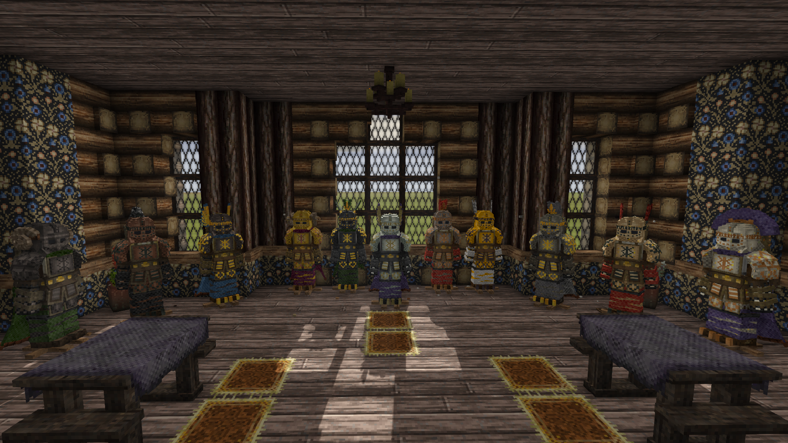
            </a>
            <figcaption>Bjarnholdr — Plate set</figcaption>
          </figure>
          <figure class="viking-card fa-introduction-set" id="ragnjorn-set">
            <a href="images/introduction/ragnjornset.png">
              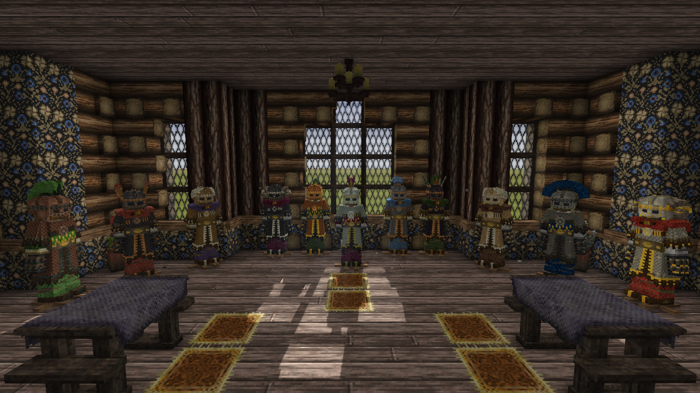
            </a>
            <figcaption>Ragnjorn — Chain set</figcaption>
          </figure>
          
</section>
<section id="bjarnholdr-helmet" class="viking-section" aria-labelledby="bjarnholdr-helmet-title">
  <h2 id="bjarnholdr-helmet-title">Bjarnholdr — Plate — Head ornaments</h2>
  
Decoration variants.

  

    <h3>Communis</h3>
    

          <figure class="viking-card">
            <a href="images/bjarnholdr-helmet/communis/pennae.png">
              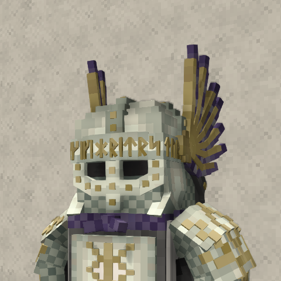
            </a>
            <figcaption>Communis-Pennae</figcaption>
          </figure>
          <figure class="viking-card">
            <a href="images/bjarnholdr-helmet/communis/pluma.png">
              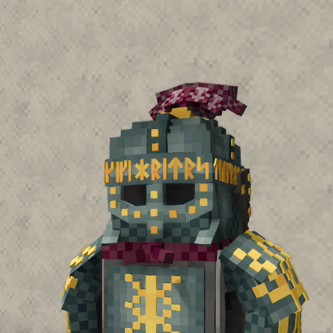
            </a>
            <figcaption>Communis-Pluma</figcaption>
          </figure>
          <figure class="viking-card">
            <a href="images/bjarnholdr-helmet/communis/crista.png">
              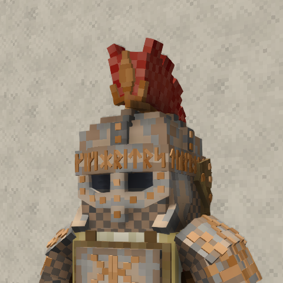
            </a>
            <figcaption>Communis-Crista</figcaption>
          </figure>
          <figure class="viking-card">
            <a href="images/bjarnholdr-helmet/communis/pinna.png">
              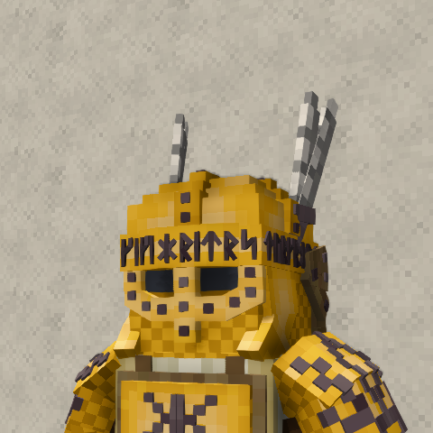
            </a>
            <figcaption>Communis-Pinna</figcaption>
          </figure>
          <figure class="viking-card">
            <a href="images/bjarnholdr-helmet/communis/sertum.png">
              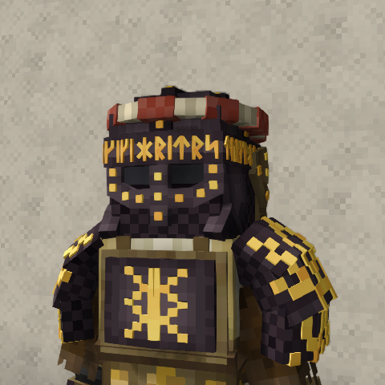
            </a>
            <figcaption>Communis-Sertum</figcaption>
          </figure>
          <figure class="viking-card">
            <a href="images/bjarnholdr-helmet/communis/transversa.png">
              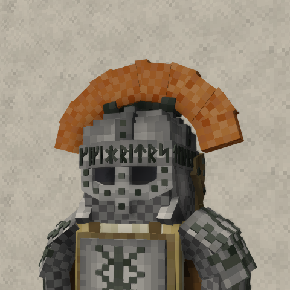
            </a>
            <figcaption>Communis-Transversa</figcaption>
          </figure>
          <figure class="viking-card">
            
            <figcaption>Communis-Vexillum</figcaption>
          </figure>
          <figure class="viking-card">
            <a href="images/bjarnholdr-helmet/communis/cauda.png">
              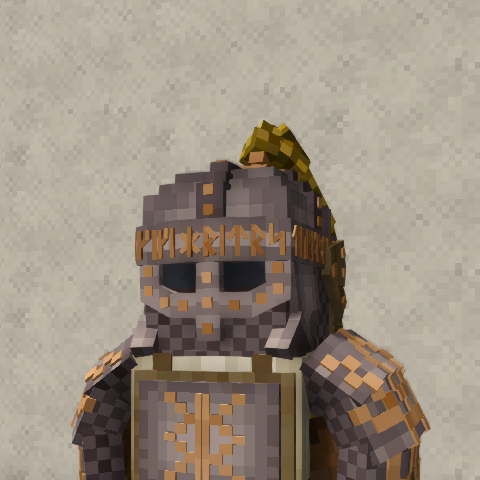
            </a>
            <figcaption>Communis-Cauda</figcaption>
          </figure>

        <figure class="viking-card">
            
            <figcaption>Communis-Laurea</figcaption>
          </figure>
        <figure class="viking-card">
            
            <figcaption>Communis-Corona</figcaption>
          </figure>
        <figure class="viking-card">
            
            <figcaption>Communis-Cervinus</figcaption>
          </figure>
        <figure class="viking-card">
            
            <figcaption>Communis-Arietinus</figcaption>
          </figure>
        <figure class="viking-card">
            
            <figcaption>Communis-Taurinus</figcaption>
          </figure>
    <figure class="viking-card">
            <a href="images/bjarnholdr-helmet/animal/bear.png">
              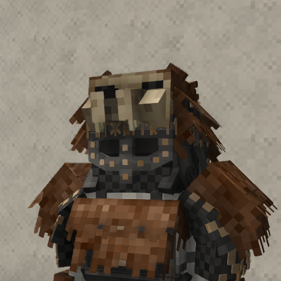
            </a>
            <figcaption>Animal-Bear</figcaption>
          </figure>
          <figure class="viking-card">
            <a href="images/bjarnholdr-helmet/animal/wolf.png">
              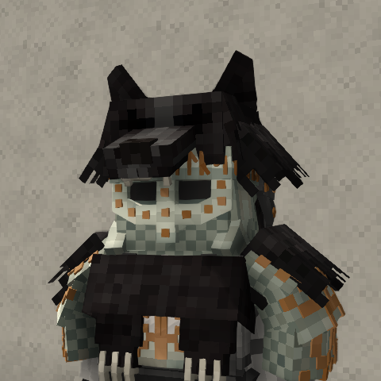
            </a>
            <figcaption>Animal-Wolf</figcaption>
          </figure>
    

  

  

    <h3>Regalis</h3>
    

          <figure class="viking-card">
            <a href="images/bjarnholdr-helmet/regalis/crista.png">
              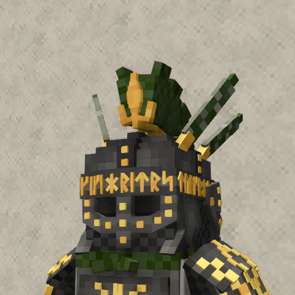
            </a>
            <figcaption>Regalis-Crista</figcaption>
          </figure>
          <figure class="viking-card">
            
            <figcaption>Regalis-Transversa</figcaption>
          </figure>
          <figure class="viking-card">
            
            <figcaption>Regalis-Pennae</figcaption>
          </figure>
          <figure class="viking-card">
            
            <figcaption>Regalis-Pinna</figcaption>
          </figure>
          <figure class="viking-card">
            <a href="images/bjarnholdr-helmet/regalis/pluma.png">
              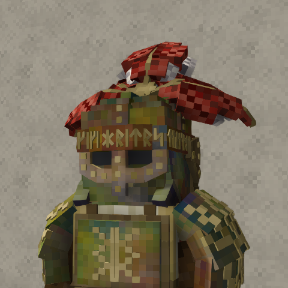
            </a>
            <figcaption>Regalis-Pluma</figcaption>
          </figure>
          <figure class="viking-card">
            <a href="images/bjarnholdr-helmet/regalis/sertum.png">
              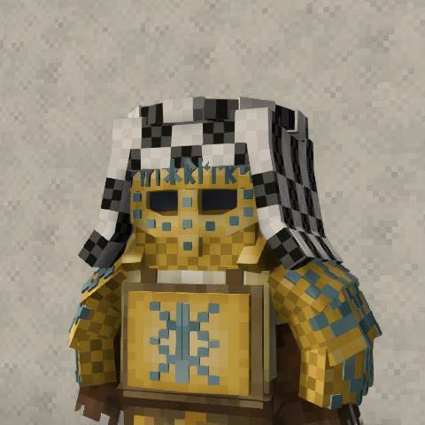
            </a>
            <figcaption>Regalis-Sertum</figcaption>
          </figure>
          <figure class="viking-card">
            
            <figcaption>Regalis-Vexillum</figcaption>
          </figure>
          <figure class="viking-card">
            
            <figcaption>Regalis-Cauda</figcaption>
          </figure>

        <figure class="viking-card">
            
            <figcaption>Regalis-Laurea</figcaption>
          </figure>
        <figure class="viking-card">
            
            <figcaption>Regalis-Corona</figcaption>
          </figure>
        <figure class="viking-card">
            
            <figcaption>Regalis-Cervinus</figcaption>
          </figure>
        <figure class="viking-card">
            
            <figcaption>Regalis-Arietinus</figcaption>
          </figure>
        <figure class="viking-card">
            
            <figcaption>Regalis-Taurinus</figcaption>
          </figure>
    

  

  

    <h3>Metallicus</h3>
    

          <figure class="viking-card">
            <a href="images/bjarnholdr-helmet/metallicus/laurea.png">
              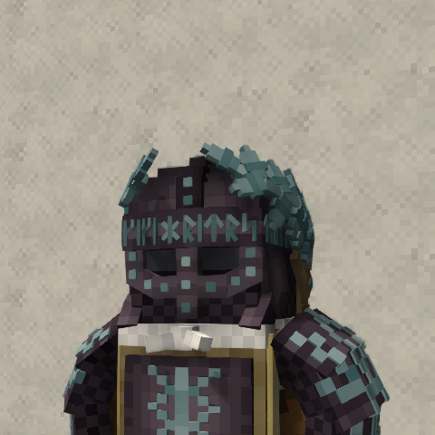
            </a>
            <figcaption>Metallicus-Laurea</figcaption>
          </figure>
          <figure class="viking-card">
            <a href="images/bjarnholdr-helmet/metallicus/corona.png">
              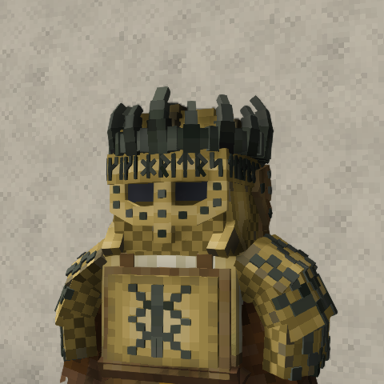
            </a>
            <figcaption>Metallicus-Corona</figcaption>
          </figure>
          <figure class="viking-card">
            
            <figcaption>Metallicus-Cervinus</figcaption>
          </figure>
          <figure class="viking-card">
            <a href="images/bjarnholdr-helmet/metallicus/arietinus.png">
              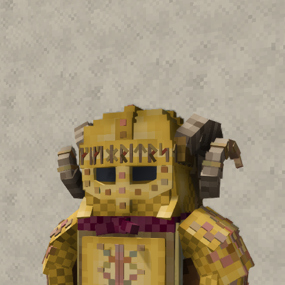
            </a>
            <figcaption>Metallicus-Arietinus</figcaption>
          </figure>
          <figure class="viking-card">
            
            <figcaption>Metallicus-Taurinus</figcaption>
          </figure>
    

  

  </section>
<section id="bjarnholdr-chestplate" class="viking-section" aria-labelledby="bjarnholdr-chestplate-title">
  <h2 id="bjarnholdr-chestplate-title">Bjarnholdr — Plate — Body brackets</h2>
  
Decoration variants.

  

    <h3>Brackets</h3>
    

          <figure class="viking-card">
            <a href="images/bjarnholdr-chestplate/brackets/insignia.png">
              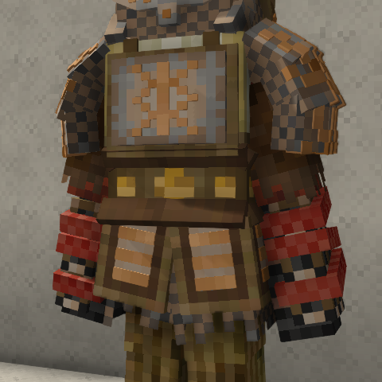
            </a>
            <figcaption>Brackets-Insignia</figcaption>
          </figure>
          <figure class="viking-card">
            
            <figcaption>Brackets-Pectorale</figcaption>
          </figure>
          <figure class="viking-card">
            
            <figcaption>Brackets-Cingulum</figcaption>
          </figure>
          <figure class="viking-card">
            <a href="images/bjarnholdr-chestplate/brackets/mantellum.png">
              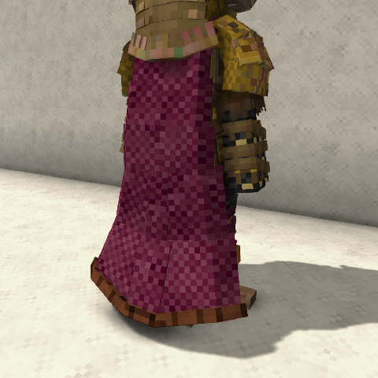
            </a>
            <figcaption>Brackets-Mantellum</figcaption>
          </figure>
          <figure class="viking-card">
            <a href="images/bjarnholdr-chestplate/brackets/vexilium.png">
              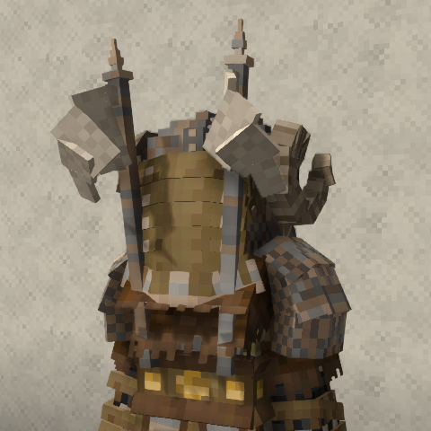
            </a>
            <figcaption>Brackets-Vexillum</figcaption>
          </figure>
          <figure class="viking-card">
            
            <figcaption>Brackets-Balterus</figcaption>
          </figure>
    <figure class="viking-card">
            <a href="images/bjarnholdr-chestplate/animal/bear.png">
              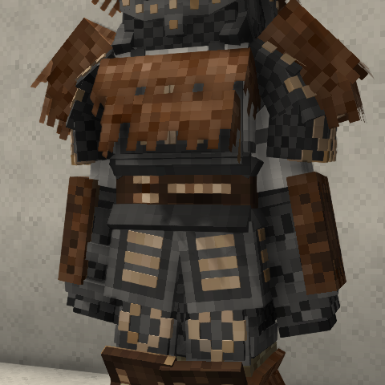
            </a>
            <figcaption>Animal-Bear</figcaption>
          </figure>
          <figure class="viking-card">
            <a href="images/bjarnholdr-chestplate/animal/wolf.png">
              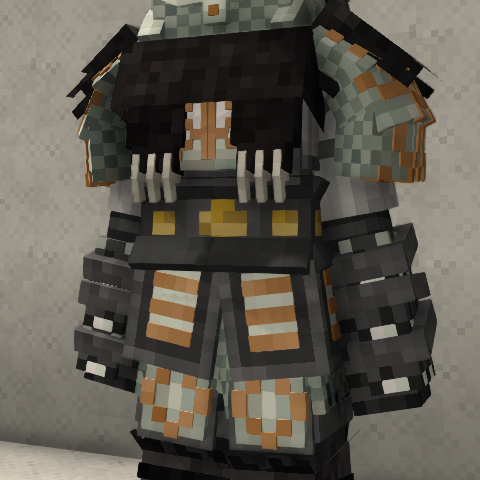
            </a>
            <figcaption>Animal-Wolf</figcaption>
          </figure>
    

  

  </section>
<section id="bjarnholdr-legplate" class="viking-section" aria-labelledby="bjarnholdr-legplate-title">
  <h2 id="bjarnholdr-legplate-title">Bjarnholdr — Plate — Legs fasteners</h2>
  
Decoration variants.

  

    <h3>Fasteners</h3>
    

          <figure class="viking-card">
            <a href="images/bjarnholdr-legplate/lacinia.png">
              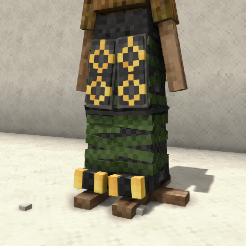
            </a>
            <figcaption>Lacinia</figcaption>
          </figure>
          <figure class="viking-card">
            
            <figcaption>Genuale</figcaption>
          </figure>
          <figure class="viking-card">
            
            <figcaption>Falda</figcaption>
          </figure>
    <figure class="viking-card">
            <a href="images/bjarnholdr-legplate/animal/bear.png">
              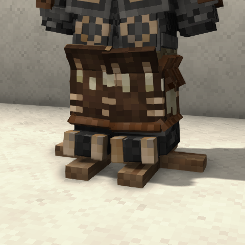
            </a>
            <figcaption>Animal-Bear</figcaption>
          </figure>
          <figure class="viking-card">
            <a href="images/bjarnholdr-legplate/animal/wolf.png">
              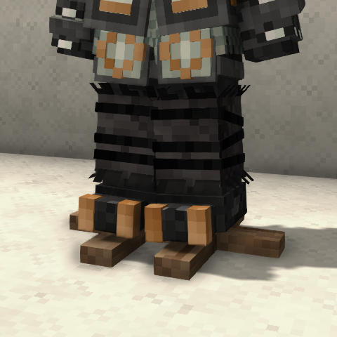
            </a>
            <figcaption>Animal-Wolf</figcaption>
          </figure>
    

  

  </section>

<section id="ragnjorn-helmet" class="viking-section" aria-labelledby="ragnjorn-helmet-title">
  <h2 id="ragnjorn-helmet-title">Ragnjorn — Chain — Head ornaments</h2>
  
Decoration variants.

  

    <h3>Communis</h3>
    

          <figure class="viking-card">
            <a href="images/ragnjorn-helmet/communis/pennae.png">
              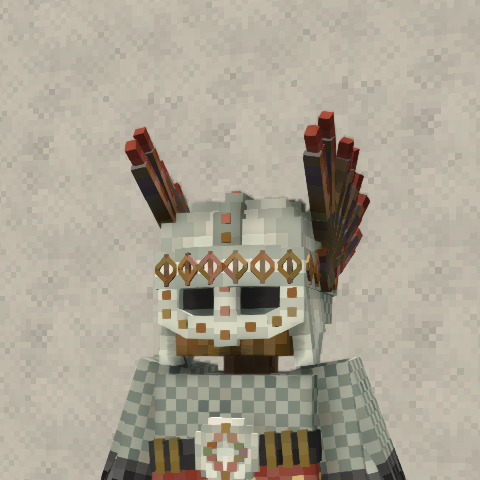
            </a>
            <figcaption>Communis-Pennae</figcaption>
          </figure>
          <figure class="viking-card">
            <a href="images/ragnjorn-helmet/communis/pluma.png">
              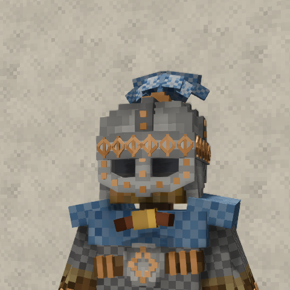
            </a>
            <figcaption>Communis-Pluma</figcaption>
          </figure>
          <figure class="viking-card">
            <a href="images/ragnjorn-helmet/communis/crista.png">
              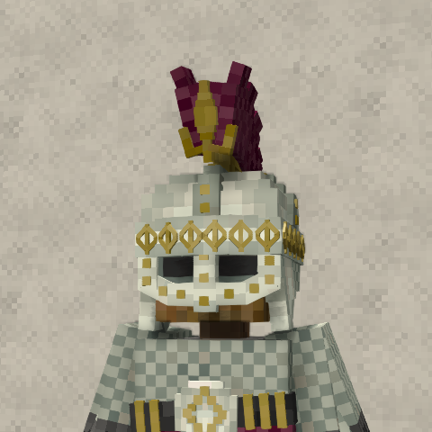
            </a>
            <figcaption>Communis-Crista</figcaption>
          </figure>
          <figure class="viking-card">
            <a href="images/ragnjorn-helmet/communis/pinna.png">
              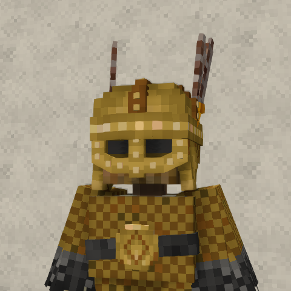
            </a>
            <figcaption>Communis-Pinna</figcaption>
          </figure>
          <figure class="viking-card">
            <a href="images/ragnjorn-helmet/communis/sertum.png">
              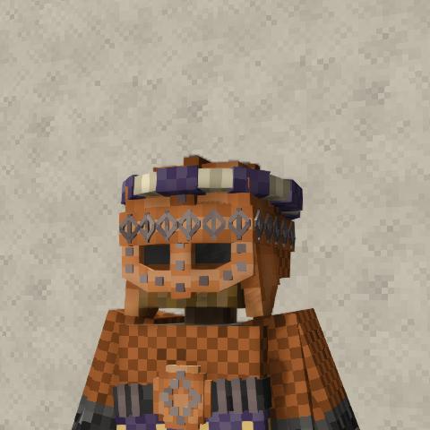
            </a>
            <figcaption>Communis-Sertum</figcaption>
          </figure>
          <figure class="viking-card">
            <a href="images/ragnjorn-helmet/communis/transversa.png">
              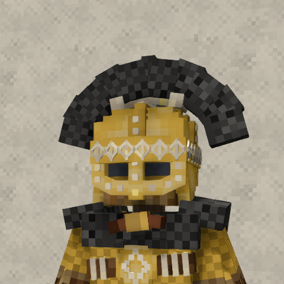
            </a>
            <figcaption>Communis-Transversa</figcaption>
          </figure>
          <figure class="viking-card">
            
            <figcaption>Communis-Vexillum</figcaption>
          </figure>
          <figure class="viking-card">
            <a href="images/ragnjorn-helmet/communis/cauda.png">
              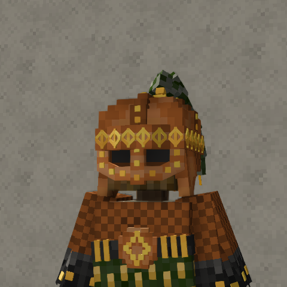
            </a>
            <figcaption>Communis-Cauda</figcaption>
          </figure>

        <figure class="viking-card">
            
            <figcaption>Communis-Laurea</figcaption>
          </figure>
        <figure class="viking-card">
            
            <figcaption>Communis-Corona</figcaption>
          </figure>
        <figure class="viking-card">
            
            <figcaption>Communis-Cervinus</figcaption>
          </figure>
        <figure class="viking-card">
            
            <figcaption>Communis-Arietinus</figcaption>
          </figure>
        <figure class="viking-card">
            
            <figcaption>Communis-Taurinus</figcaption>
          </figure>
    <figure class="viking-card">
            <a href="images/ragnjorn-helmet/animal/bear.png">
              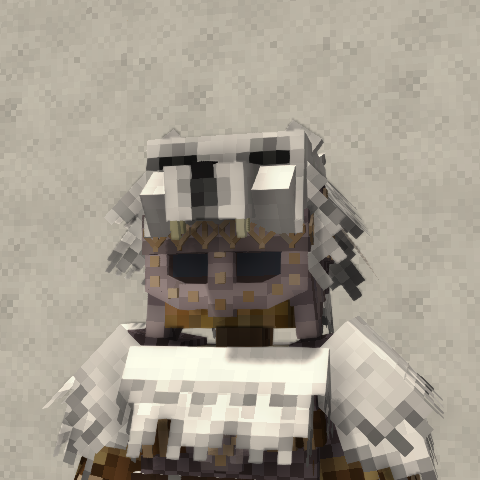
            </a>
            <figcaption>Animal-Bear</figcaption>
          </figure>
          <figure class="viking-card">
            <a href="images/ragnjorn-helmet/animal/wolf.png">
              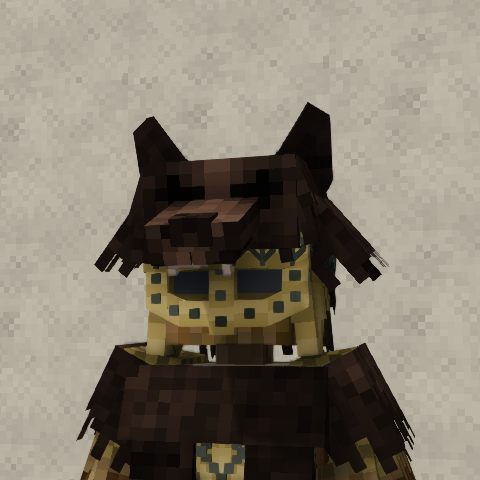
            </a>
            <figcaption>Animal-Wolf</figcaption>
          </figure>
    

  

  

    <h3>Regalis</h3>
    

          <figure class="viking-card">
            <a href="images/ragnjorn-helmet/regalis/crista.png">
              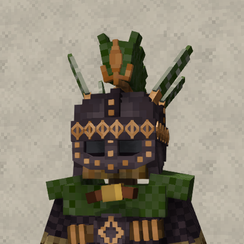
            </a>
            <figcaption>Regalis-Crista</figcaption>
          </figure>
          <figure class="viking-card">
            
            <figcaption>Regalis-Transversa</figcaption>
          </figure>
          <figure class="viking-card">
            
            <figcaption>Regalis-Pennae</figcaption>
          </figure>
          <figure class="viking-card">
            
            <figcaption>Regalis-Pinna</figcaption>
          </figure>
          <figure class="viking-card">
            <a href="images/ragnjorn-helmet/regalis/pluma.png">
              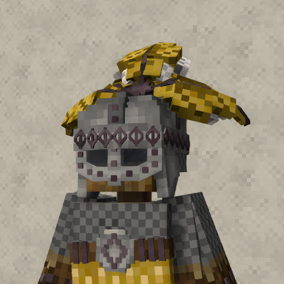
            </a>
            <figcaption>Regalis-Pluma</figcaption>
          </figure>
          <figure class="viking-card">
            <a href="images/ragnjorn-helmet/regalis/sertum.png">
              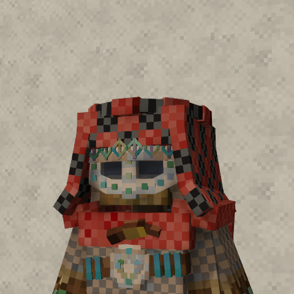
            </a>
            <figcaption>Regalis-Sertum</figcaption>
          </figure>
          <figure class="viking-card">
            
            <figcaption>Regalis-Vexillum</figcaption>
          </figure>
          <figure class="viking-card">
            
            <figcaption>Regalis-Cauda</figcaption>
          </figure>

        <figure class="viking-card">
            
            <figcaption>Regalis-Laurea</figcaption>
          </figure>
        <figure class="viking-card">
            
            <figcaption>Regalis-Corona</figcaption>
          </figure>
        <figure class="viking-card">
            
            <figcaption>Regalis-Cervinus</figcaption>
          </figure>
        <figure class="viking-card">
            
            <figcaption>Regalis-Arietinus</figcaption>
          </figure>
        <figure class="viking-card">
            
            <figcaption>Regalis-Taurinus</figcaption>
          </figure>
    

  

  

    <h3>Metallicus</h3>
    

          <figure class="viking-card">
            <a href="images/ragnjorn-helmet/metallicus/laurea.png">
              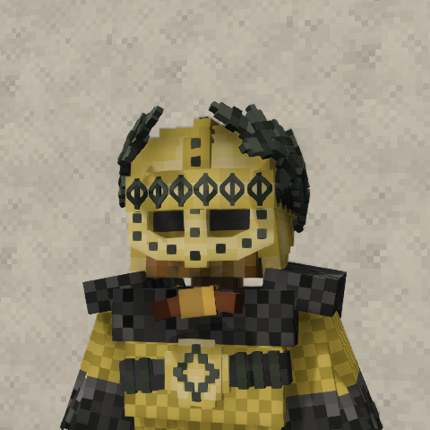
            </a>
            <figcaption>Metallicus-Laurea</figcaption>
          </figure>
          <figure class="viking-card">
            <a href="images/ragnjorn-helmet/metallicus/corona.png">
              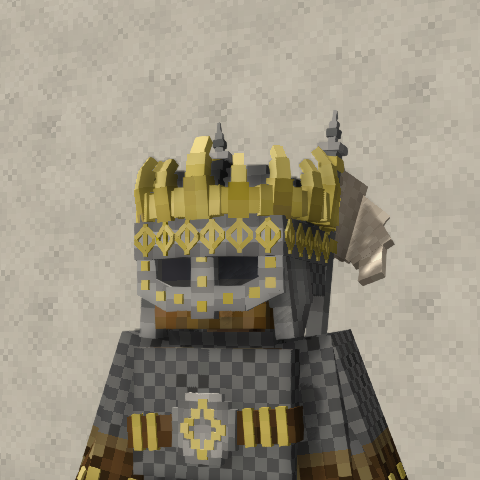
            </a>
            <figcaption>Metallicus-Corona</figcaption>
          </figure>
          <figure class="viking-card">
            
            <figcaption>Metallicus-Cervinus</figcaption>
          </figure>
          <figure class="viking-card">
            <a href="images/ragnjorn-helmet/metallicus/arietinus.png">
              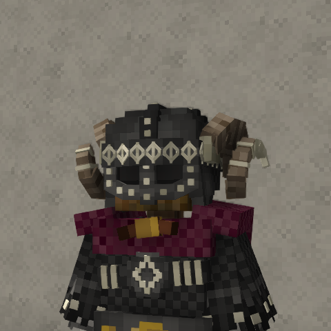
            </a>
            <figcaption>Metallicus-Arietinus</figcaption>
          </figure>
          <figure class="viking-card">
            
            <figcaption>Metallicus-Taurinus</figcaption>
          </figure>
    

  

  </section>
<section id="ragnjorn-chestplate" class="viking-section" aria-labelledby="ragnjorn-chestplate-title">
  <h2 id="ragnjorn-chestplate-title">Ragnjorn — Chain — Body brackets</h2>
  
Decoration variants.

  

    <h3>Brackets</h3>
    

          <figure class="viking-card">
            <a href="images/ragnjorn-chestplate/brackets/insignia.png">
              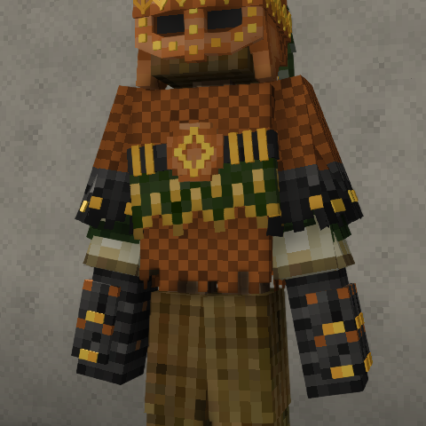
            </a>
            <figcaption>Brackets-Insignia</figcaption>
          </figure>
          <figure class="viking-card">
            
            <figcaption>Brackets-Pectorale</figcaption>
          </figure>
          <figure class="viking-card">
            
            <figcaption>Brackets-Cingulum</figcaption>
          </figure>
          <figure class="viking-card">
            <a href="images/ragnjorn-chestplate/brackets/mantellum.png">
              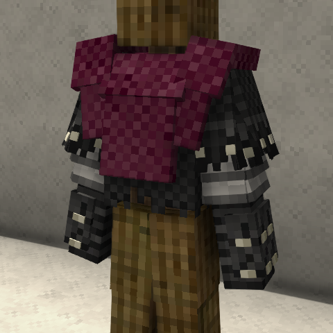
            </a>
            <figcaption>Brackets-Mantellum</figcaption>
          </figure>
          <figure class="viking-card">
            <a href="images/ragnjorn-chestplate/brackets/vexilium.png">
              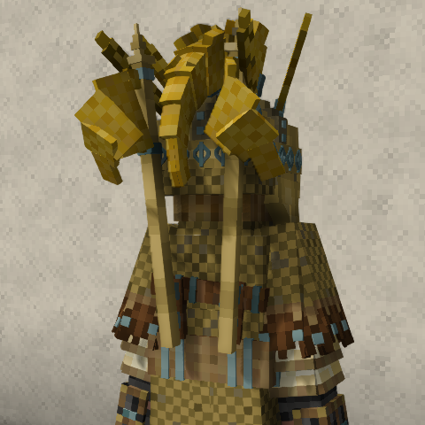
            </a>
            <figcaption>Brackets-Vexillum</figcaption>
          </figure>
          <figure class="viking-card">
            
            <figcaption>Brackets-Balterus</figcaption>
          </figure>
    <figure class="viking-card">
            <a href="images/ragnjorn-chestplate/animal/bear.png">
              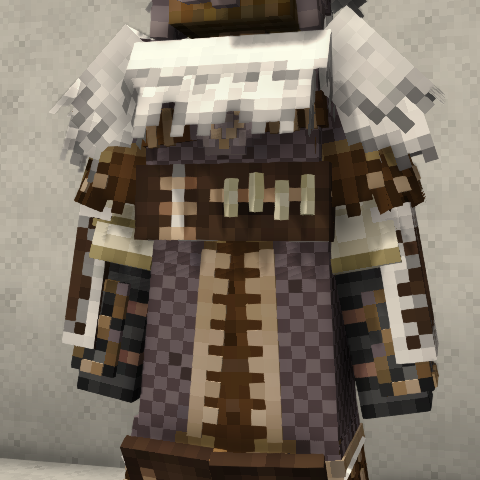
            </a>
            <figcaption>Animal-Bear</figcaption>
          </figure>
          <figure class="viking-card">
            <a href="images/ragnjorn-chestplate/animal/wolf.png">
              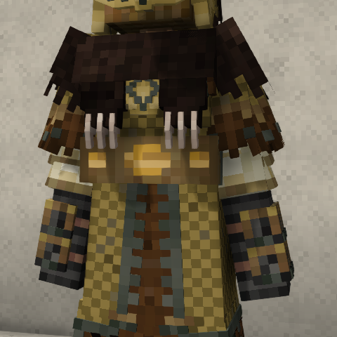
            </a>
            <figcaption>Animal-Wolf</figcaption>
          </figure>
    

  

  </section>
<section id="ragnjorn-legplate" class="viking-section" aria-labelledby="ragnjorn-legplate-title">
  <h2 id="ragnjorn-legplate-title">Ragnjorn — Chain — Legs fasteners</h2>
  
Decoration variants.

  

    <h3>Fasteners</h3>
    

          <figure class="viking-card">
            <a href="images/ragnjorn-legplate/lacinia.png">
              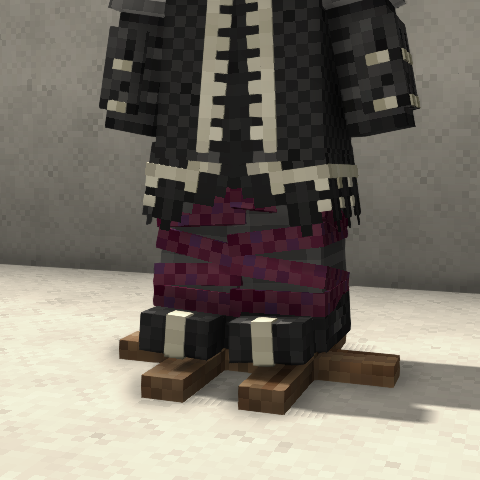
            </a>
            <figcaption>Lacinia</figcaption>
          </figure>
          <figure class="viking-card">
            
            <figcaption>Genuale</figcaption>
          </figure>
          <figure class="viking-card">
            
            <figcaption>Falda</figcaption>
          </figure>
    <figure class="viking-card">
            <a href="images/ragnjorn-legplate/animal/bear.png">
              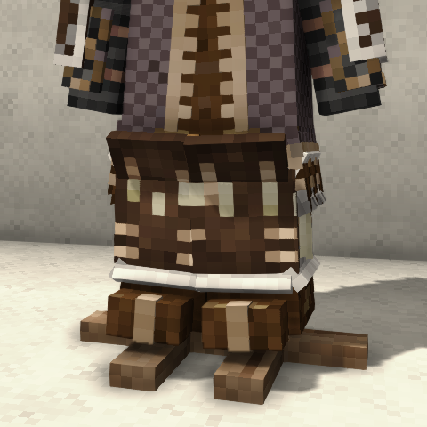
            </a>
            <figcaption>Animal-Bear</figcaption>
          </figure>
          <figure class="viking-card">
            <a href="images/ragnjorn-legplate/animal/wolf.png">
              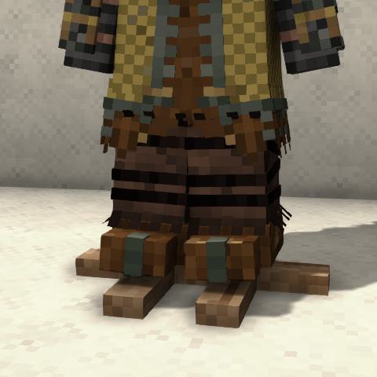
            </a>
            <figcaption>Animal-Wolf</figcaption>
          </figure>
    

  

  </section>

<section id="poses" class="viking-section fa-poses" aria-labelledby="poses-title"><h2 id="poses-title">Poses</h2><section class="fa-pose-set" id="bjarnholdr-poses"><h3 id="bjarnholdr-poses-title">Bjarnholdr set</h3>
<figure class="viking-card">
            <a href="images/poses/bjarnholdr/iron/bjarnholdrironpose1.png" aria-label="Open Bjarnholdr — Iron — Pose 1">
              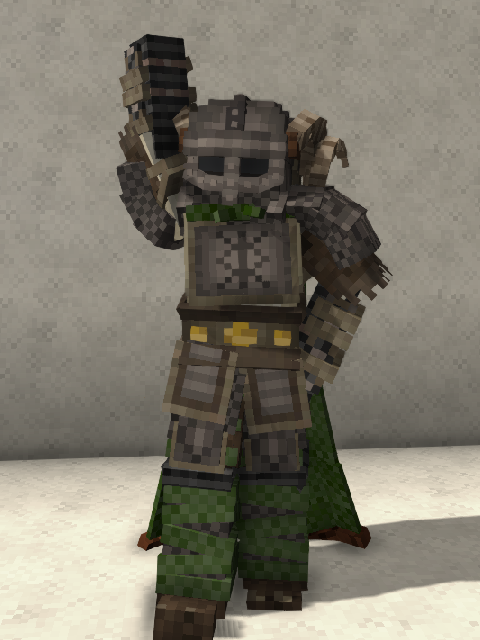
            </a>
            <figcaption>Bjarnholdr — Iron — Pose 1</figcaption>
          </figure>
          <figure class="viking-card">
            <a href="images/poses/bjarnholdr/iron/bjarnholdrironpose2.png" aria-label="Open Bjarnholdr — Iron — Pose 2">
              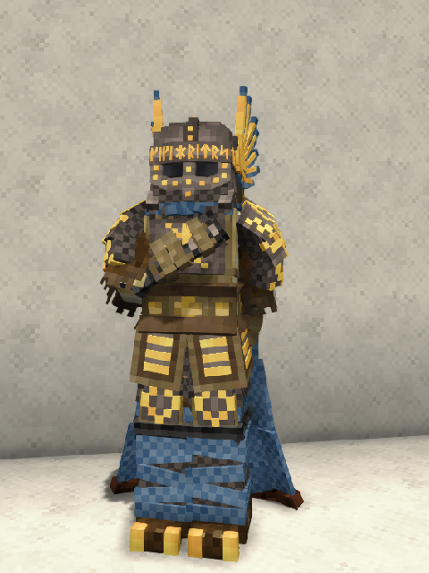
            </a>
            <figcaption>Bjarnholdr — Iron — Pose 2</figcaption>
          </figure>
        <figure class="viking-card">
            
            <figcaption>Bjarnholdr — Meteoric Iron — Pose 1</figcaption>
          </figure>
          <figure class="viking-card">
            
            <figcaption>Bjarnholdr — Meteoric Iron — Pose 2</figcaption>
          </figure>
        <figure class="viking-card">
            
            <figcaption>Bjarnholdr — Steel — Pose 1</figcaption>
          </figure>
          <figure class="viking-card">
            
            <figcaption>Bjarnholdr — Steel — Pose 2</figcaption>
          </figure>
        
</section><section class="fa-pose-set" id="ragnjorn-poses"><h3 id="ragnjorn-poses-title">Ragnjorn set</h3>
<figure class="viking-card">
            
            <figcaption>Ragnjorn — Iron — Pose 1</figcaption>
          </figure>
          <figure class="viking-card">
            
            <figcaption>Ragnjorn — Iron — Pose 2</figcaption>
          </figure>
        <figure class="viking-card">
            
            <figcaption>Ragnjorn — Meteoric Iron — Pose 1</figcaption>
          </figure>
          <figure class="viking-card">
            
            <figcaption>Ragnjorn — Meteoric Iron — Pose 2</figcaption>
          </figure>
        <figure class="viking-card">
            
            <figcaption>Ragnjorn — Steel — Pose 1</figcaption>
          </figure>
          <figure class="viking-card">
            
            <figcaption>Ragnjorn — Steel — Pose 2</figcaption>
          </figure>
        
</section></section>

  <section class="note">

    
Return to the full Forgotten Armory directory.

    <a href="{{ '/vintage-story/forgotten-armory/' | relative_url }}">Forgotten Armory ←</a>
  
</section>
  <section class="note">

    
Find Aladar’s mods on Vintage Story ModDB.

    <a href="https://mods.vintagestory.at/show/user/922a98ad603bda6d92eb">All mods on ModDB ↗</a>
  
</section>

